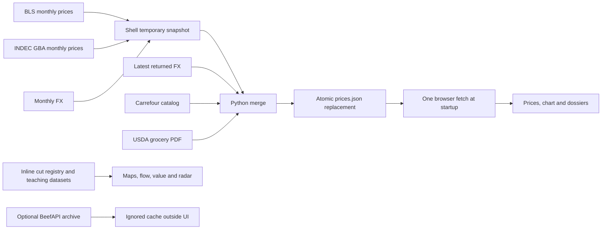
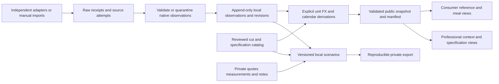

# Make Beef Chart Trustworthy and Useful

**Comprehensive project review — October 12, 2026.** Beef Chart is a working, visually distinctive Argentine/U.S. beef atlas and a frozen, mixed-source retail-price comparison. It has a strong starting point for both meat enthusiasts and professionals, but its present evidence handling, anatomical relationships, documentation and accessibility prevent dependable professional use. The best next step is to repair the existing reference and pricing contract, then complete two connected journeys: **understand → choose → buy → prepare** and **specify → compare quotes → measure yield → cost**. The static application can remain economical; a framework rewrite is not a prerequisite. This report reviews the current content, functionality, architecture, documentation, price data, recent committed changes and every category of current uncommitted change. It identifies **80 distinct opportunities: 32 corrections to existing behavior or claims and 48 proposed enhancements**, with priorities, solutions, acceptance criteria, dependencies and indicative effort. These are an actionable planning inventory, not a claim that every possible enhancement has been discovered or that all 80 should be implemented. No application repair, live scrape, staging, commit, push, deployment or publication was performed.

## 1. A useful beef atlas currently outruns its evidence contract

### The actual system is small enough to understand end to end

The reader encounters an editorial introduction, paired Argentine retail-cut and U.S. primal diagrams, a ground-beef benchmark and quick search, a carcass-flow Sankey, a retail-price lollipop chart, a value treemap, six popular-cut cards and four specialty entries. A selected cut opens a dossier with translated names, broad preparation method, tenderness/marbling estimates, available price evidence, a sensory radar and a recipe-search link. Accent normalization, synchronized cross-diagram highlighting, per-source descriptions, explicit missing prices and the current visual identity are valuable foundations. The specialty **bife de costilla remains distinct from boneless strip and T-bone**, and correctly displays “Not available” when its own observation is absent. Preserve that refusal to borrow another cut's price. ([Catalog](/Users/ryanjohnson/Projects/beef-chart/index.html:1133), [specialty records](/Users/ryanjohnson/Projects/beef-chart/index.html:1168), [price lookup](/Users/ryanjohnson/Projects/beef-chart/index.html:1189))

The core is a **1,844-line zero-build HTML file** containing base CSS, embedded domain records, schematic geometry, D3 rendering, calculations, state and events. A separate 27-line compressed override stylesheet supplies the Bauhaus treatment. Two shell scripts, one standard-library Python scraper and one unittest-compatible test file support data operations; the latter contains eight methods. The repository includes WebP images, a 402-line price snapshot, README, architecture/cut/pipeline guides and a roadmap. It has no tracked frontend dependency manifest, formal JSON schema, historical observation store, CI workflow, deployment configuration or actual LICENSE file. These absences define the present scope; they do not make an enterprise stack necessary. ([Application](/Users/ryanjohnson/Projects/beef-chart/index.html:1122), [architecture](/Users/ryanjohnson/Projects/beef-chart/docs/architecture.md:82), [tests](/Users/ryanjohnson/Projects/beef-chart/tests/test_retail_prices.py:19), [README](/Users/ryanjohnson/Projects/beef-chart/README.md:54))

| Area | Implemented today | Partial, inconsistent or absent |
|---|---|---|
| Cut reference | 20 mapped Argentine retail cuts, four specialty entries, nine U.S. primals; bilingual names and broad method notes | Full specification catalog, reviewed standard identifiers, sourced crosswalks, complete Spanish operation and verified anatomy |
| Discovery | Accent-insensitive Enter/button search; map/card selection; synchronized categorical highlight | Candidate results, no-result feedback, full keyboard directory, meaningful primal dossier and contextual navigation |
| Consumer preparation | Grill/braise/roast categories, editorial cut guide, generic web recipe search | Reviewed cut/form-specific preparation, safety/storage layers, portions, meal planning, substitutions and nutrition |
| Prices | 17 U.S. and 19 Argentine records from monthly surveys, weekly features and retailer listings; some native/FX evidence | Current purchasable-offer eligibility, universal provenance, reliable per-source refresh health, history and comparable cohorts |
| Visualization | Cow maps, Sankey, lollipop, treemap, radar | Complete text/table equivalents; consistent mass/value assumptions; robust narrow-screen and dependency-failure behavior |
| Professional decisions | Terminology and retail context useful for orientation | Product specifications, private supplier quotes, actual lot yield, usable cost, traceable market history and reproducible scenarios |
| Recovery and portability | Static files can be served locally | Persisted task state, deep-link recovery, backup/import, tested cold offline reference and print/export layouts |
| Delivery and acceptance | Bounded local source/browser review; useful atomic write safeguards | Full production/browser/device/assistive-technology acceptance, provider acceptance and professional field validation |

The current runtime pipeline separates inline reference content from external price data. `fetch-prices.sh` assembles BLS/INDEC/monthly-FX data into a temporary JSON file; `scrape-retail.py` adds latest-returned FX, Carrefour catalog results and USDA grocery-feature PDF results. Same-directory replacement and the shell trap protect against a partially written snapshot. The browser then makes **one startup fetch** of `data/prices.json`. It does not stream market prices or query a provider while the reader browses. The optional BeefAPI script archives enrichment separately; it does not supply the visible glossary. ([Orchestrator](/Users/ryanjohnson/Projects/beef-chart/fetch-prices.sh:28), [merge](/Users/ryanjohnson/Projects/beef-chart/scrape-retail.py:193), [browser fetch](/Users/ryanjohnson/Projects/beef-chart/index.html:1841), [optional archive](/Users/ryanjohnson/Projects/beef-chart/fetch-beef.sh:2))

### Thirty-six records represent several different kinds of evidence

The checked snapshot was retrieved on **October 7**, but its BLS/INDEC observations cover **August 2026**, USDA records carry **October 2**, Carrefour records carry **October 7**, and latest-returned FX is dated **August 31**. That FX is 37 days older than the catalog date and 42 days old on the review date. Fifteen of the 19 Argentine records lack the promised per-record FX rate/date/basis fields; only molleja, rinon, lengua and bife_angosto carry them. Conversions reconcile within **0.00501 USD/lb** using recorded rates where available and an inferred monthly/daily basis for legacy records. This supports arithmetic consistency under those assumptions; it does not prove original provider authenticity, an appropriate conversion date or current purchase availability. ([Snapshot](/Users/ryanjohnson/Projects/beef-chart/data/prices.json:2), [legacy AR fields](/Users/ryanjohnson/Projects/beef-chart/data/prices.json:142), [FX](/Users/ryanjohnson/Projects/beef-chart/data/prices.json:386), [current arithmetic review](</Users/ryanjohnson/Projects/beef-chart/research_notes/Beef chart comprehensive review/code_pipeline.md:19>))

The particularly low specialty values deserve qualification before interpretation. Molleja is stored at **1,830 ARS/kg / $0.55 USD/lb**, kidney at **279.9 ARS/kg / $0.08 USD/lb**, and tongue at a median **1,680 ARS/kg / $0.50 USD/lb**. The tongue median comes from 655, 1,680 and 10,900 ARS/kg listings. **Every underlying specialty listing is out of stock.** The modal discloses that status; the cards expose the number without it. Stored listing evidence lacks measurement-unit/multiplier fields and an original raw receipt. Obsolete catalog values, offer errors and other origins remain unknown. The demonstrated synthetic parser defect below must not be presented as the proven cause of these actual bundled numbers, and there is no supported allegation that the values were fabricated. ([Molleja](/Users/ryanjohnson/Projects/beef-chart/data/prices.json:277), [kidney](/Users/ryanjohnson/Projects/beef-chart/data/prices.json:303), [tongue](/Users/ryanjohnson/Projects/beef-chart/data/prices.json:329), [card formatter](/Users/ryanjohnson/Projects/beef-chart/index.html:1193), [modal qualification](/Users/ryanjohnson/Projects/beef-chart/index.html:1574))

The source classes answer different questions. BLS monthly average prices are price-level estimates from eligible CPI observations; grocery features represent advertised prices; INDEC GBA selected-item prices retain a specific geography; catalog offers describe a retailer's listed products. A normalized USD/lb difference can provide context, but it cannot establish the same product, quality, sale channel, tax treatment, population or purchase opportunity. The existing footer's “compare cuts loosely” qualification is useful, but should travel with each comparison. ([BLS method](https://www.bls.gov/cpi/factsheets/average-prices.htm), [USDA grocery-feature method](https://www.ams.usda.gov/market-news/grocerystore), [INDEC datasets](https://www.indec.gob.ar/indec/web/Nivel4-Tema-3-5-31), [existing qualification](/Users/ryanjohnson/Projects/beef-chart/index.html:1838))

### The evidence ledger keeps current results distinct from background and unknowns

| Evidence class | What this review establishes | What it does not establish |
|---|---|---|
| Current local source/data/Git | Current tracked files, snapshot counts/fields/arithmetic, clean tracked main and source-visible behavior | Live remote freshness, real-world stock/quotes, accepted upstream rights or current production revision |
| Current offline reproduction | Inconsistent unit/species/preparation matching, prior-only USDA date error, no-match deletion/unchanged fetched timestamp | That particular bundled records originated from the synthetic failing inputs |
| Current bounded browser | Desktop 1440 px; true 390 px/320 px mobile emulation; unnamed retail dialog, inaccessible diagrams/chart context, visible clipping/overlap; simulated D3/Sankey/JSON failure | Real screen-reader/device operation, Safari/Firefox, full WCAG conformance, print or cold offline acceptance |
| Selected existing test | One failure-preservation test passed | All eight tests passing, real PDF layout correctness or live-provider acceptance |
| Current primary-source research | Readable standards/methodology/consumer safety/nutrition references and candidate feed documentation | Working new adapter, complete amendments, permission to copy every source asset or professional workflow adoption |
| October 9 review artifacts | Earlier finding/backlog structure and dated browser/graph evidence; several defects independently persist | A fresh clean-tree claim or a fresh successful graph run on October 12 |
| Unresolved | Provider authenticity/raw receipts, actual low inactive-price origins, full anatomical crosswalk, source rights, production and human acceptance | Neither a pass nor a failure should be inferred for these unperformed stages |

The current research notes provide the detailed evidence trail: [code/pipeline/Git](</Users/ryanjohnson/Projects/beef-chart/research_notes/Beef chart comprehensive review/code_pipeline.md>), [content/browser experience](</Users/ryanjohnson/Projects/beef-chart/research_notes/Beef chart comprehensive review/content_experience.md>), and [standards/market/dual-audience research](</Users/ryanjohnson/Projects/beef-chart/research_notes/Beef chart comprehensive review/market_product.md>). No full suite, graph reindex, production audit, live refresh, professional interview or paid/authenticated source exercise was performed.

## 2. Git is tracked-clean, while the documents need a shared account of reality

### All current uncommitted changes are review artifacts

At review start, branch **`main` at `bc27966f4ea2e9682532bbbb13126b198fba1e5b`** had empty staged and unstaged tracked diffs. The only preexisting untracked files were the October 9 report and its three research notes. This review adds three new research notes and this report. Consequently, the application and bundled data have no new uncommitted implementation patch to review; the substantive uncommitted changes are eight documentation/research artifacts across the two dated reviews. These files remain untracked and are not approval to implement or publish their recommendations. Live remote freshness is unknown because no fetch or remote comparison was performed. ([Current Git review](</Users/ryanjohnson/Projects/beef-chart/research_notes/Beef chart comprehensive review/code_pipeline.md:60>))

| File or group | Status and substantive review |
|---|---|
| [Beef market professional review.md](</Users/ryanjohnson/Projects/beef-chart/reports/Beef market professional review.md>) | Preexisting untracked, 269-line October 9 report: strong inventory, 21 finding groups, 72 opportunities and staged professional-market roadmap. Its findings are proposals, not implementation. |
| [Prior code_review.md](</Users/ryanjohnson/Projects/beef-chart/research_notes/Beef market professional review/code_review.md>) | Preexisting untracked: useful offline reproductions and historical graph results; current source/pipeline checks reconfirm major defects, while the old cached runner is now unusable. |
| [Prior content_functionality.md](</Users/ryanjohnson/Projects/beef-chart/research_notes/Beef market professional review/content_functionality.md>) | Preexisting untracked: dated browser evidence, including Escape/focus and actual-500 px overflow. This pass adds actual 390/320 evidence and keeps inconsistent current automation findings qualified. |
| [Prior market_research.md](</Users/ryanjohnson/Projects/beef-chart/research_notes/Beef market professional review/market_research.md>) | Preexisting untracked: extensive physical-market, trade and optional hedging research with access/rights caveats. Current research rechecks selected essential sources; old regulatory/contract details remain dated background. |
| [Current code_pipeline.md](</Users/ryanjohnson/Projects/beef-chart/research_notes/Beef chart comprehensive review/code_pipeline.md>) | Newly authored review evidence: current source/data/Git, bounded fixtures, arithmetic and graph-runtime limitations. |
| [Current content_experience.md](</Users/ryanjohnson/Projects/beef-chart/research_notes/Beef chart comprehensive review/content_experience.md>) | Newly authored review evidence: current content/docs, desktop/mobile and dependency/data failure simulations. |
| [Current market_product.md](</Users/ryanjohnson/Projects/beef-chart/research_notes/Beef chart comprehensive review/market_product.md>) | Newly authored review evidence: current primary-source reference boundaries, consumer/professional journeys and source candidates. |
| [This comprehensive report](</Users/ryanjohnson/Projects/beef-chart/reports/Beef chart comprehensive review.md>) | Newly authored synthesis: reconciles current evidence, corrects historical framing and gives both requested audiences substantive scope. |

The prior report deserves preservation as dated evidence. It correctly separates provider URLs from accepted integrations, notes incomplete real-world/AT validation and offers actionable dependencies and acceptance criteria. Its initial “clean tree” statement was true before its own artifacts existed, but is stale when repeated as today's whole-tree condition. Its October 9 FX age and successful cached graph commands are also historical. Its two priority scales—finding severity P1 versus foundational backlog P0—should be normalized. Most importantly, its decision to subordinate cooking/editorial work to professional market research no longer fits this request: **enthusiast workflows should receive equal design attention**, while trade and hedging remain optional. The new report supersedes the earlier prioritization for this request without silently rewriting its history. ([Prior scope and phases](</Users/ryanjohnson/Projects/beef-chart/reports/Beef market professional review.md:229>), [current reconciliation](</Users/ryanjohnson/Projects/beef-chart/research_notes/Beef chart comprehensive review/code_pipeline.md:65>))

### Six recent commits explain the strengths and the remaining gaps

| Commit | What it added or changed | Deep-review consequence |
|---|---|---|
| `6e001bf` | Five files; pipeline/snapshot, optional enrichment and initial tests | Atomic output is worth retaining. Legacy match rules and effective-week identity remain incomplete. |
| `7694cb3` | Thirteen files; guides, roadmap and graph material | Better onboarding, but live/complete accessibility/schema/yield claims exceed evidence. |
| `38abaf3` | Per-record FX generation and two USDA tests | Generation improvement was not a complete old-data migration. Mocked parser tests do not verify real-layout date/column behavior. |
| `8b127a4` | D3 fallback, missing prices, modal focus/semantics and highlighting | Real improvements survive alongside an early D3 crash boundary, unnamed regular dialog and conflicting close lifecycle. |
| `fbcb024` | Documentation reconciliation | Clearer naming/FX text still does not resolve universal matching, conformance or empirical yield/value assertions. |
| `bc27966` | Snapshot only: 110 additions/10 removals; offal and chorizo evidence | Code is unchanged; all new offal are unavailable catalog references, bife_costilla stays absent and old top-level fetched is retained. |

This history was inspected through the current source, newest data patch and earlier detailed commit review. It is not an uncommitted change set. The GitNexus index records `fbcb024`, one data-only commit behind HEAD; the code is therefore unchanged across that specific index gap. However, the current wrapper query stayed silent and was terminated, and the earlier cached runner failed with `MODULE_NOT_FOUND`. **No current successful graph analysis or fresh impact all-clear exists.** Earlier low Python fanout and unresolved inline-JavaScript targets remain historical evidence; they do not resolve today's runtime or target coverage. Any implementation must satisfy the project's graph requirements with working tooling before editing relevant symbols. ([Current graph limitations](</Users/ryanjohnson/Projects/beef-chart/research_notes/Beef chart comprehensive review/code_pipeline.md:54>), [index metadata](/Users/ryanjohnson/Projects/beef-chart/.gitnexus/meta.json), [prior commit review](</Users/ryanjohnson/Projects/beef-chart/reports/Beef market professional review.md:42>))

### Documentation should describe one catalog, one method and dated verification

The documentation has useful explanations but drifts across files. README calls the app live/real-time and fully keyboard accessible; roadmap checkmarks imply WCAG AA and compliant modal acceptance; architecture calls the static gallery a carousel and the value treemap a weight/yield model. Pipeline documentation describes strict/all-record provenance and parsing coverage that the actual code, snapshot and fixtures do not establish. “Open index.html” is also unreliable for the JSON-fetching route, and root-server instructions expose repository/private paths. These are correctable accuracy issues, not reasons to discard the documentation. ([README](/Users/ryanjohnson/Projects/beef-chart/README.md:15), [architecture](/Users/ryanjohnson/Projects/beef-chart/docs/architecture.md:47), [pipeline](/Users/ryanjohnson/Projects/beef-chart/docs/data-pipeline.md:29), [roadmap](/Users/ryanjohnson/Projects/beef-chart/roadmap.md:29))

| Document | Proposed role | Specific reconciliation |
|---|---|---|
| README | Short orientation and safe start/resume | State static snapshot/cadences, audience journeys and actual implemented scope; provide public-artifact loopback launcher rather than root serving. |
| Architecture guide | Owning modules, state and dependency boundaries | Describe actual charts and data flow; label future design explicitly; name fallback and privacy/publication boundaries. |
| Cut guide | Reviewed bilingual anatomy/preparation reference | Generate core identities from canonical catalog; fix entraña; source typed relationships, imagery and preparation assumptions. |
| Data-pipeline guide | Source methods, units, dates, statuses and transforms | Separate observation/publication/retrieval; describe empty/error/reference behavior, actual FX fields and parser acceptance. |
| Roadmap | Ordered tasks with dependencies and exit evidence | Replace completion checkmarks without evidence; separate corrections, enthusiast journey, professional journey and optional breadth. |
| Operator runbook, proposed | Low-input refresh, diagnose, recover and back up | Give bounded owner actions, source status/recovery and exact artifact paths; avoid routine full-suite or repeated reindex demands. |
| Reports/research notes | Dated review and decision evidence | Preserve historical dates/limits; link accepted recommendations from roadmap without representing proposals as shipped. |

## 3. Thirty-two current corrections restore trust and operability

Priorities use one scale throughout: **P1** must be resolved before relying on the affected workflow; **P2** materially improves correctness, usability or maintenance; **P3** is later polish or optional breadth. Effort is indicative: **S** a bounded fix/content change, **M** several connected components, **L** a new subsystem or complete journey. These are relative estimates, not duration commitments. Audience codes are **B** both audiences, **C** consumers/enthusiasts and **P** professionals. Dependencies reference other opportunity IDs; “—” means no listed backlog prerequisite. Acceptance criteria are proposed future checks, not tests written or run during this review.

### Price evidence needs consistent semantics before more sources are added

Offline fixtures reproduce three important semantic failures. A legacy bife-de-chorizo match accepts a **0.5 kg pack**, unit `un`, multiplier `.5`, price `10000` as **10,000 ARS/kg**; stricter checks apply only to four newer keys. Cooked lomo, goat/pork descriptions and even rabbit molleja can pass different parts of the current matching rules. A prior-only USDA row yields `$9/lb` labeled with the current report date instead of its prior feature interval. A successful empty targeted refresh removes the old reference, updates FX and leaves the old `fetched` timestamp untouched. These inputs demonstrate code behavior, not live-source errors or origins of specific stored records. ([Matching split](/Users/ryanjohnson/Projects/beef-chart/scrape-retail.py:68), [units](/Users/ryanjohnson/Projects/beef-chart/scrape-retail.py:79), [prior-week fallback](/Users/ryanjohnson/Projects/beef-chart/scrape-retail.py:155), [remove/merge](/Users/ryanjohnson/Projects/beef-chart/scrape-retail.py:204))

Atomic replacement protects bytes but not meaning. One failing Carrefour query, FX response or PDF parse prevents healthy official-source data from advancing in the current all-or-nothing merge. A proper design retains that atomic final promotion while staging independent source results and recording their outcomes. Likewise, retaining an old number is useful only when its original date and status survive; it must never be silently promoted as a new offer. ([Fetch order](/Users/ryanjohnson/Projects/beef-chart/scrape-retail.py:199), [shell promotion](/Users/ryanjohnson/Projects/beef-chart/fetch-prices.sh:66), [atomic output](/Users/ryanjohnson/Projects/beef-chart/scrape-retail.py:218))

| ID / priority | Current issue and proposed solution | Acceptance | Audience / effort / dependencies |
|---|---|---|---|
| C01 / P1 | Unequal unit checks allow pack totals to masquerade as kg prices. Apply one sale-unit/quantity contract to every cut; normalize packs only from complete weight evidence. | Half-kilogram/unit, unknown-pack and mismatched-multiplier fixtures reject/quarantine or produce a proved conversion. | B / S / — |
| C02 / P1 | Name blacklists do not establish bovine/raw identity. Require supported species/category evidence and explicit raw/prepared form across all keys. | Cooked, pig, goat, rabbit and unknown-species fixtures cannot become unqualified raw-beef quotes. | B / S / C01 |
| C03 / P1 | Prior-only USDA value takes current report date. Store actual feature interval, report publication and fallback reason separately. | Prior-only fixture retains prior interval; current/prior joins cannot invent freshness. | B / S / — |
| C04 / P1 | Tests do not establish real PDF numeric-column parsing. Add retained, dated real-layout fixtures and validate headers/weights/columns before accepting a report. | Known totals/weighted result reconcile; shifted/missing columns classify parse failure. | B / M / C03 |
| C05 / P1 | Empty refresh deletes reference without attempt history. Separate current availability, immutable observations and refresh attempts. | Empty success differs from error; original last-good date/value remains retrievable but inactive. | B / M / C12 |
| C06 / P2 | One adapter failure blocks healthy outputs. Stage independent results and promote one validated manifest atomically. | A failed catalog adapter permits healthy official-source advance with explicit dated fallback/health. | B / M / C05,C09,C12 |
| C07 / P1 | Fifteen AR records omit promised FX provenance. Migrate with proved, inferred or unknown basis; never fabricate original evidence. | All 19 AR records expose truthful FX status; export does not imply inferred metadata is proved. | B / S / — |
| C08 / P1 | Latest-returned FX is mistaken for fresh FX. Define source/convention/as-of/lag policy and display rate date beside conversion. | August 31 remains visibly old; future-date joins reject; missing/stale FX leaves native data usable. | B / M / C07 |
| C09 / P1 | Object existence and finite-only checks admit null/zero/negative or malformed chart values. Validate complete payload and positive finite monetary values centrally. | Missing region, null FX, bad type/negative/nonfinite cases neither crash nor draw a zero price. | B / M / — |
| C10 / P2 | Previous available BLS observation is labeled previous month and lacks its date; API order/M-period assumptions are unchecked. Parse/sort valid periods and retain previous effective date. | Missing-month/synthetic M13/order fixtures produce an accurate interval or rejection, without alleging a live BLS defect. | B / S / C09 |
| C11 / P1 | Unavailable offal prices look purchasable on cards. Make current/inactive-reference status consistent across card, chart, dossier and future export. | All three out-of-stock specialty records are qualified before opening; absent bife_costilla remains absent. | B / S / C05 |
| C12 / P1 | One top-level fetched timestamp cannot describe heterogeneous updates. Add generated time and per-source/per-record retrieval, effective and publication fields. | Targeted refresh records its actual attempt; newly fetched old observations stay old. | B / M / — |
| C13 / P1 | Mixed source prices imply interchangeable country comparison. Show channel, geography, interval and method beside normalized values. | GBA/monthly survey, advertised feature and catalog offer remain visibly distinct; no universal cheapest-market claim. | B / S / C12 |
| C14 / P2 | First 20 hits/first seller hide sampling limits. Record sampled count, seller/region and truncation; add bounded coverage only where supported. | Median names its population; incomplete pagination stays visible; no claim of exhaustive retailer coverage. | B / M / C01,C02 |

### Browser failures affect real counter and kitchen tasks

At normal desktop boot the page renders the 29 map paths and prices. Current browser evidence nevertheless shows **an unnamed ordinary retail dialog**, background content still present in the accessibility tree, maps omitted from the tree and all 29 clickable paths without keyboard semantics. Chart source/date/FX tooltips and radar values lack complete accessible alternatives. The existing focus trap moved between close and recipe controls in a bounded check, but current focus-restoration/native keyboard results were inconsistent under automation. The October 9 Escape failure was reproduced then, and the competing close listeners remain in source; this pass does not claim a newly conclusive native-keyboard reproduction. ([Dialog association](/Users/ryanjohnson/Projects/beef-chart/index.html:1114), [ordinary title](/Users/ryanjohnson/Projects/beef-chart/index.html:1611), [map events](/Users/ryanjohnson/Projects/beef-chart/index.html:1251), [close logic](/Users/ryanjohnson/Projects/beef-chart/index.html:1591), [current browser limits](</Users/ryanjohnson/Projects/beef-chart/research_notes/Beef chart comprehensive review/content_experience.md:46>))

True mobile emulation adds stronger current evidence than the prior review. At **390 px**, the modal has **348 px client width and 448 px scroll width**, and its right price column is visibly clipped. At **320 px**, the page has no overall horizontal overflow, yet lollipop price labels overlap and “Other primals” extends beyond the Sankey SVG. Hiding page overflow does not make those values readable. The images were inspected inline; no screenshot artifact was saved. ([Fixed modal grid](/Users/ryanjohnson/Projects/beef-chart/index.html:1616), [fixed chart margin](/Users/ryanjohnson/Projects/beef-chart/index.html:1446), [label placement](/Users/ryanjohnson/Projects/beef-chart/index.html:1476), [mobile evidence](</Users/ryanjohnson/Projects/beef-chart/research_notes/Beef chart comprehensive review/content_experience.md:49>))

Failure simulations reveal precise dependency boundaries. Removing core D3 and fallback insertion from a temporary copy causes an unguarded `d3.select` to throw before base search/modal/data initialization. Removing Sankey alone leaves maps and prices functional but disables all three charts because the shared predicate requires Sankey. Removing JSON leaves maps usable and displays “Price data unavailable,” though the provenance note remains blank and no classified retry/help state appears. The JSON fallback is a retained strength; base initialization and individual chart guards need repair. These are isolated dependency/data absence simulations, not observed live CDN/provider outages. ([D3 loader](/Users/ryanjohnson/Projects/beef-chart/index.html:10), [fatal startup](/Users/ryanjohnson/Projects/beef-chart/index.html:1247), [chart guards](/Users/ryanjohnson/Projects/beef-chart/index.html:1333), [data fallback](/Users/ryanjohnson/Projects/beef-chart/index.html:1798))

| ID / priority | Current issue and proposed solution | Acceptance | Audience / effort / dependencies |
|---|---|---|---|
| C15 / P1 | Regular dialog references absent title ID. Use stable title association for every cut/record type. | Every opened dossier has the same visible and accessible name. | B / S / — |
| C16 / P1 | Duplicate close handling conflicts with cleanup. Route Escape/button/backdrop through one state/focus lifecycle. | Each real close path updates state and restores initiating focus; report historical/current reproduction separately. | B / S / C15 |
| C17 / P1 | Opacity-hidden controls and non-isolated background weaken modal lifecycle. Use native dialog or explicit hidden/inert equivalent. | Closed controls leave navigation; open background is isolated; trapping/restoration verified independently. | B / S / C16 |
| C18 / P1 | Full map catalog has no keyboard/AX route. Provide an operable full cut/primal directory with synchronized selection. | Every record reachable without hover; map and list expose the same dossier/context. | B / M / C20 |
| C19 / P1 | Chart information has no complete table/summary. Add associated data tables, country/source/date keys and accessible selection. | Every plotted number and qualification is available without pointer/color; radar heuristics include values/method. | B / M / C09,C18 |
| C20 / P1 | Core D3 absence aborts base app. Initialize catalog/search/status/price text independently and isolate chart failures. | No-D3 fixture retains a usable reference and truthful price status without startup exception. | B / M / — |
| C21 / P2 | Missing Sankey disables unrelated charts. Detect/load each chart dependency separately. | Sankey-only failure disables flow only; price/value charts remain available. | B / S / C20 |
| C22 / P1 | 390 px modal clipping and 320 px unreadable charts. Stack narrow dossiers; switch dense plots to readable table/reader layouts. | Actual 320/390 widths preserve full values/controls; later zoom/text-spacing checks separately recorded. | B / M / C19 |
| C23 / P2 | Search opens first substring result with no ambiguity/no-result state. Return ranked candidates/status and honor or remove “charts” promise. | “rib” offers choices; unknown query explains recovery; existing accents/aliases still work. | B / M / C18 |
| C24 / P2 | Primals/Other/fixed arrows open arbitrary children. Provide genuine primal/Other explanations and contextual selected-list navigation. | Destination matches label and selected context; back/next does not silently replace it. | B / S / C18 |
| C25 / P1 | Root serving exposes .env/.git paths and default server is not loopback-only. Generate a public allowlist and serve 127.0.0.1 through a short launcher. | Private paths/receipts never resolve from artifact; complete JSON route works without file-origin assumptions. | B / S / — |

No credential content was read or leak exercised. The root-server risk follows the documented command and serveable paths; `.gitignore` is not a web-server deny rule. Popular cards already have role/tabindex, but source event semantics and tool activation differ enough that a blanket keyboard-pass or blanket newly reproduced card-failure claim would overstate this review. Use native controls in the accessibility repair and validate them directly. ([Serving instructions](/Users/ryanjohnson/Projects/beef-chart/README.md:90), [credential input](/Users/ryanjohnson/Projects/beef-chart/fetch-beef.sh:9), [card handlers](/Users/ryanjohnson/Projects/beef-chart/index.html:1757))

### Content should distinguish anatomy, teaching assumptions and preparation evidence

The guide's **entraña fina → inside skirt** contradicts the app's outside-skirt label. Current USMEF regional vocabulary supports entraña fina/outside skirt and separates falsa entraña/inside skirt and entraña gruesa/hanging tender. This establishes a useful qualified anatomical relationship; an unspecified retailer's “skirt” still needs preparation/spec evidence. Argentina's original SENASA nomenclador distinguishes **vacío**, containing several abdominal-wall muscles/fascias, from **bife de vacío**, the rectus-abdominis portion. The report therefore does not silently replace vacío with a one-to-one U.S. flank definition. Current amendments and every regional mapping remain subject to specialist review. ([Local contradiction](/Users/ryanjohnson/Projects/beef-chart/docs/cuts-guide.md:63), [USMEF dictionary](https://usmefsudamerica.org/corte-de-res/), [SENASA original annex](https://www.argentina.gob.ar/normativa/nacional/resoluci%C3%B3n-1128-1999-60581/texto), [published USDA specification](https://www.ams.usda.gov/sites/default/files/media/IMPS_100_Fresh_Beef%5B1%5D.pdf))

Matambre wording also disagrees across UI/guide, while aguja/chuck and regional bone-in steak labels need preparation boundaries. Replace simple equivalence strings with evidence-bearing edges: exact within specified preparation, partial overlap, adjacent anatomy, culinary alternative or unresolved. Keep independent code namespaces and editions rather than harmonizing conflicting catalogs by name. USDA IMPS is a voluntary purchasing-specification resource, not an inspection certificate; quality grade, yield grade, breed, feeding claims and certification are independent dimensions. ([Current mappings](/Users/ryanjohnson/Projects/beef-chart/index.html:1141), [guide](/Users/ryanjohnson/Projects/beef-chart/docs/cuts-guide.md:85), [IMPS catalog](https://www.ams.usda.gov/grades-standards/imps), [USDA grade standard](https://www.ams.usda.gov/sites/default/files/media/CarcassBeefStandard.pdf))

The diagrams need different kinds of truth. The Sankey labels flows as carcass percentages but totals **104%**: nine primal shares already sum to 100, then “Other” adds 4. The treemap sums 100 but depicts fixed retail **value** shares, not weight/yield or a calculation from current prices. The radar derives most axes from broad grill/braise categories and fixed cut constants, without empirical scale/sample/method. “Illustrative” is useful, but does not resolve impossible mass balance or apparent sensory precision. ([Flow](/Users/ryanjohnson/Projects/beef-chart/index.html:1364), [value model](/Users/ryanjohnson/Projects/beef-chart/index.html:1495), [radar](/Users/ryanjohnson/Projects/beef-chart/index.html:1653))

| ID / priority | Current issue and proposed solution | Acceptance | Audience / effort / dependencies |
|---|---|---|---|
| C26 / P1 | Docs claim live, complete accessibility, validation and unproved acceptance. Replace with implemented/verified/planned wording and dated evidence. | README/roadmap/architecture/pipeline/UI agree; no checkmark substitutes for verification. | B / S / C01–C25 |
| C27 / P1 | Entraña fina definition contradicts atlas. Correct to qualified outside-skirt relationship and review downstream attachment of generic skirt observations. | Same sourced anatomy/qualifiers in guide/UI/mapping; unknown retailer identity stays unknown. | B / S / — |
| C28 / P1 | Vacío/matambre/aguja/bone-in name mappings overstate identity. Replace with typed reviewed relationships and unresolved qualifiers. | Partial/culinary mappings never export as exact procurement equivalents; costilla/strip/T-bone stay distinct. | B / M / C27 |
| C29 / P1 | Carcass percentages total 104. Reconcile one denominator and flow conservation from shared inputs. | Declared whole sums 100; every node/link explanation accounts for included/excluded mass. | B / S / — |
| C30 / P2 | Value treemap is documented as weight/yield. Rename consistently and expose fixed assumptions rather than pretending it is measured. | UI/docs distinguish value allocation, weight, fabrication and cooking yield. | B / S / C29 |
| C31 / P2 | Radar/tenderness precision lacks evidence. Label scale/method/heuristic status or replace with qualified practical traits. | No implied measured flavor/grade; dependencies on preparation/animal/trim are explicit. | B / S / — |
| C32 / P1 | Fixed cooking times, universal cultural copy and “Authentic Recipes” label exceed evidence. Qualify technique/time assumptions and label web search truthfully. | No timing-only safety reassurance; link label matches generic search; cultural practices allow variation. | C / S / — |

## 4. Forty-eight enhancements connect reference knowledge to useful decisions

### One shared evidence model can serve two equally serious journeys

For enthusiasts, the intended completed task is finding an unfamiliar/local name, identifying its form, comparing useful alternatives, checking local/date-qualified price context, preparing a bilingual butcher card, calculating an editable amount and opening appropriate preparation/storage guidance. For professionals, it is selecting a reviewed specification, capturing two actual supplier quotes, exposing mismatches, recording measured or assumed yield, reproducing effective usable cost and saving/exporting the evidence. Both need low-input recovery, clear unknowns and complete keyboard/table operation. Professional use has been explicitly requested; this does not imply monetization, accounts or a marketplace.

| Task | Enthusiast outcome | Professional outcome | Shared evidence required |
|---|---|---|---|
| Find/identify | Understand an alias and where/how the cut is prepared | Resolve supplier vocabulary to reviewed product spec | Stable identity, country alias, anatomy, preparation and typed relationship |
| Compare | Explain texture/method/quantity tradeoffs of a substitute | Decide whether two quotes meet the same purchasing requirement | Product form, bone/trim, qualifiers, source and unresolved differences |
| Buy/cost | Editable meal quantity and local shopping estimate | Purchased-to-usable/portion cost with actual terms and losses | Native currency/unit, explicit yields, costs/credits and observation/quote validity |
| Prepare/use | Slicing/trimming/method and applicable safety/storage reference | Fabrication/training information and operator-specific procedure boundary | Reviewed sources, product form, measured versus assumed results |
| Resume/export | Reopen favorite cut/meal/butcher card with minimal input | Reopen quote/spec/lot comparison and reproduce original calculation | Saved state, versioned inputs, provenance and backup |

Cooking content should distinguish outcome preferences from measured safety. U.S. FSIS consumer guidance recommends **145°F/62.8°C with a three-minute rest for beef steaks/chops/roasts**, **160°F/71.1°C for ground meat**, and **165°F/73.9°C for leftovers**. Mechanically tenderized form matters because the process can move surface bacteria inward; it should not inherit an intact-steak preference profile without the applicable guidance. These references support a proposed U.S. consumer layer, not Argentine-specific advice or an establishment's approved process. Add offal guidance only from a reviewed category-specific source, rather than extrapolating steak targets. ([FSIS safe-temperature chart](https://www.fsis.usda.gov/food-safety/safe-food-handling-and-preparation/food-safety-basics/safe-temperature-chart), [mechanically tenderized beef](https://www.fsis.usda.gov/food-safety/safe-food-handling-and-preparation/meat/mechanically-tenderized-beef))

Storage/handling should retain jurisdiction and source date. FSIS describes refrigerated whole-cut storage of 3–5 days, ground beef/variety meats 1–2 days, refrigeration at 40°F/4.4°C or below, and refrigerator/cold-water/microwave thawing methods. Nutrition needs an exact cut/form/lean-fat/raw-cooked match, not a generic beef record. FoodData Central provides downloadable data and an API, with public-domain/CC0 data and requested attribution; curated offline records avoid putting a private API key in the static client. This review did not match nutrient records or validate recipes. ([FSIS beef handling](https://www.fsis.usda.gov/food-safety/safe-food-handling-and-preparation/meat-catfish/beef-farm-table), [FDC API/data rights](https://fdc.nal.usda.gov/api-guide/), [FDC record methodology](https://fdc.nal.usda.gov/Foundation_Foods_Documentation/))

### The architecture should add evidence boundaries while preserving simple delivery

Separate the **cut**, **source product**, **price observation**, **transformation** and **user scenario**. A cut record owns names/anatomy/standard versions; a retailer SKU or supplier specification owns actual preparation qualifications; an observation owns native value, stage, geography, interval, method/status and receipt; a derived number references exact FX/unit/date rules; a saved scenario owns user assumptions and source vintage. Market stage and weight basis remain distinct: unit conversion cannot turn liveweight cattle into saleable meat, or a calculated wholesale cutout into a retail quote. The USDA cutout example reports USD per 100 lb and calculated industry-yield context, illustrating why a wholesale series needs its own contract. ([USDA report example](https://mymarketnews.ams.usda.gov/filerepo/sites/default/files/2453/2026-02-18/1305325/ams_2453_01525.pdf), [cutout method](https://www.ams.usda.gov/sites/default/files/media/LMRBoxedBeefCutoutsUserGuide.pdf))

This is a proposed target, not present architecture. Small Python adapters, a local append-only structure or SQLite, generated static JSON and small zero-build ES modules are sufficient candidates. Private quote/notes/raw receipts stay outside the public artifact. Introduce remote authentication or shared storage only if a later chosen workflow requires it. Keep basic cut lists and explanations available before chart libraries initialize. Source status belongs in the reader experience as meaningful freshness/error information; parser implementation details belong in the evidence drawer/runbook.

| ID / priority | Enhancement and practical value | Concrete solution and acceptance | Audience / effort / dependencies |
|---|---|---|---|
| E01 / P1 | Canonical reviewed catalog eliminates divergent anatomy/docs | Stable IDs, species, muscles, boundaries, names, geometry and sources; generate core UI/docs facts. Every reference resolves and every claim is reviewed or provisional. | B / M / C27,C28 |
| E02 / P1 | Product qualifications prevent name-only specification | Independent bone/membrane/trim/portion/fresh-frozen/grade/breed/feeding/certification fields with standard namespace/version. No inferred grade translation. | B / M / E01 |
| E03 / P2 | Full EN/ES operation supports both markets | Locale dictionaries, reviewed translations, language spans and locale-aware dates/numbers. All controls and evidence states operate consistently in either language. | B / M / E01 |
| E04 / P1 | Native unit/currency choices make comparisons inspectable | Exact lb/kg/cwt engine with separate live/dressed/product basis and displayed rounding only. Native→derived value reproduces; changing units never changes product basis. | B / M / C07,C08,C09,E02 |
| E05 / P1 | Comparison eligibility explains hidden mismatches | Comparable/qualified/incompatible result by spec, stage, time, geography and method. Intentional mismatches show reasons or decline ranking. | B / M / C13,E02,E04 |
| E06 / P1 | Source registry makes coverage/rights/refresh manageable | Record owner, report/series, cadence, method, transport, access, terms and approved use. Existing and candidate sources have explicit acceptance states. | B / S / C12,C13 |
| E07 / P1 | Original receipts make numbers independently traceable | Retain raw artifact/hash, retrieval, source URI and parser/schema version. Each new accepted observation resolves to its original evidence. | B / M / E06 |
| E08 / P1 | Immutable history preserves revisions and last-good evidence | Append-only observations/revisions with publication and effective intervals. Original/revised vintages reopen; no refresh overwrites historical meaning. | B / L / C05,C06,E07 |
| E09 / P2 | Small modules clarify ownership and graph visibility | Separate catalog, validation/units, state, renderer and chart modules; consolidate readable CSS tokens. Bounded existing journeys remain equivalent after extraction. | B / M / C20,E01,E04 |
| E10 / P2 | Safe source-string rendering supports future imports | Use text nodes and validated links for external/user data, with suitable policy. Markup/URL fixture stays literal or rejected; no exploit is alleged today. | B / S / C09,E09 |
| E11 / P2 | Pinned local dependencies reduce network fragility | Version local D3/Sankey/font assets and independent optional loading. Identity is reproducible and base reference operates with network dependencies absent. | B / M / C20,C21,C25 |
| E12 / P2 | Bounded refresh and concurrency avoid waste/lost output | Adapter timeout/retry/cache budgets, lock or compare-and-swap, rollback and classified status. Concurrent/failed refresh preserves valid artifact; unchanged sources avoid needless retrieval. | B / M / C06,E06,E08 |
| E13 / P2 | Reproducible local setup minimizes recovery input | Minimal runtime/tool manifest and short start/refresh/diagnose aliases. Fresh documented environment serves the safe artifact without global assumptions or retyping long commands. | B / S / C25,E11 |
| E14 / P2 | Code/data/image provenance removes licensing and image ambiguity | Intended LICENSE plus separate asset/data rights manifest; source/generation/representative-cut labels and correct alt/photo matching. Unknown rights remain unknown, not asserted open. | B / M / E06 |
| E15 / P2 | Documentation/runbook keeps evidence and operation aligned | Implemented/verified/planned matrix, glossary, source methods and low-input recovery. Every claim has owner/evidence/date; About opens meaningful methodology. | B / M / C26,E01,E06,E13 |
| E16 / P1 | Journey-based acceptance prevents premature completion claims | Small schema/catalog/fault gates plus separately recorded expert/device/AT tasks. Passing deterministic checks never auto-marks professional or human acceptance. | B / M / C01–C32,E15 |

### Enthusiast features should complete shopping and preparation tasks

Industry references already provide bilingual cut charts, training guides, cooking applications and yield resources. Their approximate yield guidance recommends operators' own testing; that supports editable/measured assumptions rather than a guaranteed portion multiplier. Beef Chart's opportunity is to connect those concepts into a compact cross-cultural task, preserve local observations and reopen it easily. The experience should be useful at a butcher counter and kitchen with short spoken searches, large controls, one-tap repeat actions and a persistent resume point. This is a proposed differentiator; no representative-user study has established it as exceptional yet. ([Foodservice reference resources](https://www.beefitswhatsfordinner.com/food-professionals/foodservice), [yield guidance](https://www.beefitswhatsfordinner.com/food-professionals/food-professionals-resource-library/yield-data), [international cut resources](https://usmef.org/export-resources/meat-cut-information))

| ID / priority | Enhancement and practical value | Concrete solution and acceptance | Audience / effort / dependencies |
|---|---|---|---|
| E17 / P2 | Task filters help choose an unfamiliar cut | Filter by method, equipment, available time, budget and practical texture; explain tradeoffs and unknowns. “Braise for six” yields reviewed candidates without pretending to predict outcome. | C / M / E01,C31,E22 |
| E18 / P2 | Side-by-side cut comparison makes alternatives understandable | Compare 2–4 cuts by form, traits, price context and adaptations. Culinary fit stays separate from anatomy/procurement identity. | B / M / E02,E05,C31 |
| E19 / P2 | Bilingual butcher card reduces naming/input burden | One-tap local name, alternate names, bone/trim/thickness/quantity and intended method; unknown details highlighted. Reopen/print the same request without retyping. | C / M / E02,E03,E27 |
| E20 / P2 | Editable portions explain purchase versus edible weight | Declare bone/edible/cooked bases and default versus measured yields. Guest count changes amount visibly; user local quote remains separate from survey context. | C / M / E04,E22 |
| E21 / P2 | Asado/mixed-meal planner coordinates whole-meal use | Combine selected cuts, servings, editable cooking order and shopping quantities; retain leftovers plan. Changed diners/yield updates all quantities with explained assumptions. | C / M / E20,E22,E23,E27 |
| E22 / P1 | Reviewed preparation dossiers supply missing practical detail | Grain/slicing, trimming/membranes, bone, thickness/equipment and method ranges with named sources. Dossier matches actual cut/form; culinary review remains a separate gate. | C / M / C32,E01,E02 |
| E23 / P1 | Source-grounded safety/storage layer prevents timing-only advice | Separate preference from product-form/jurisdiction-specific temperature/rest/handling/thawing/storage guidance. Every safety assertion links reviewed authoritative evidence; professional process is not assumed. | C / M / E02,E22 |
| E24 / P2 | Curated preparation/recipe sources improve provenance | Named Argentine/U.S. expert recipes or transparent outbound links with quantity/temperature units and use rights. No generic search is marketed as curated authentic instruction. | C / M / C32,E14,E22,E23 |
| E25 / P2 | Matched nutrition supports meaningful serving comparison | Curated FDC IDs/date/type, raw-cooked, lean-fat and edible portion basis; 100 g and serving views. Unknown nutrients stay missing; cooked lean-only cannot silently represent raw fat-on. | C / M / E02,E20,E06 |
| E26 / P2 | Personal notes build a repeatable reference | Local favorite methods/equipment, actual purchase/cooked weights and results with export/import. Restart and backup retain notes without account setup. | C / M / E27 |
| E27 / P1 | Persisted state/deep links lower reconstruction effort | Save language/units/selection, favorites and versioned meal/task state; stable URLs and brief voice-friendly repeat actions. Restart/back/forward restores the task in minimal actions. | B / M / E01,E03,E04 |
| E28 / P2 | Offline/print reference works away from desktop | Dated local reference cache, clear stale-price status, compact print/safety/butcher sheets and readable type. Cold offline lookup and printed source/qualifier layout pass their own checks. | B / M / E11,E14,E15,E23,E27 |

### Professional features should begin with real quotes and measured yield

A practical professional workbench can begin with manual quotes rather than waiting for a supplier API. Capture product specification, supplier/region, quantity, quote expiry, delivery/payment/tax terms and attachments privately. Normalize only known eligible unit/currency dimensions and show unresolved qualifications. Then permit a measured fabrication/cooking yield or an explicitly labeled assumption. For purchased weight `W`, native price `P`, applicable allocated costs `C`, credits `B` and saleable yield `y`, the proposed definition is **saleable cost = `(W × P + C − B)/(W × y)`**, with consistent currency/units and `0 < y ≤ 1`. Cooking loss is a separate stage; margin and markup use different denominators. These are model definitions awaiting operator validation, not observed business results.

The current Sankey/treemap must not supply lot yields automatically. A whole-animal ledger needs a declared denominator and mutually exclusive cuts/trim/bone/fat/byproducts/waste, with visible tolerance and actual measured outcomes separate from reference guidance. A small domestic quote-to-usable-cost workflow is the first professional milestone; cross-border landed cost, rule tracking and advanced market analysis should follow demonstrated needs.

| ID / priority | Enhancement and practical value | Concrete solution and acceptance | Audience / effort / dependencies |
|---|---|---|---|
| E29 / P1 | Reviewed product/spec sheets replace ambiguous order names | IMPS/SENASA namespaces/editions, buyer trim/bone/grade/weight/aging/packing/state and exceptions. Completed export still highlights unreviewed relationships and unspecified fields. | P / L / E01,E02,E14 |
| E30 / P1 | Private quote archive retains actual purchase context | Manual offers with supplier, validity, amount/unit, volume, delivery/payment/tax and evidence. Offers, transactions and invoices remain distinct; reopen original qualification. | P / M / E02,E04,E27 |
| E31 / P2 | Quote imports reduce repeated entry | Optional CSV/manual templates with row/field validation and evidence attachments. Errors explain correction; imported private text never enters public artifact. | P / M / E10,E30 |
| E32 / P1 | Measured fabrication yield grounds economics | Input mass→saleable cuts/trim/bone/fat/waste ledger with reference versus measured labels. Lot balances declared mass/tolerance and preserves original measurement. | P / L / C29,E02,E04,E30 |
| E33 / P1 | Effective saleable cost exposes low-price traps | Native purchase price, fabrication yield, labor/freight/packaging and credits; transparent sensitivity. Another reviewer reproduces usable kg/lb cost without hidden defaults. | P / L / E04,E30,E32 |
| E34 / P2 | Cooked portion/menu costing connects procurement to service | Separate cooking yield, portion size, allocated costs and optional target price; margin/markup labeled independently. Per-serving result reconciles with usable mass and explicit assumptions. | P / M / E20,E33 |
| E35 / P2 | Whole-animal destination planning helps avoid unsold output | Mutually exclusive cuts/byproducts and intended sale/use destinations, mass and revenue scenarios. No overlapping cut double-counting or implied guaranteed outlet. | P / L / E32,E33 |
| E36 / P2 | Professional substitution worksheet respects tolerances | Compare spec/processing/yield/customer constraints separately from culinary alternative. Unapproved overlap cannot silently satisfy purchase requirement. | P / M / E05,E29,E32 |
| E37 / P1 | Saved evidence-bearing calculations make review reproducible | Immutable scenario input/version/observation IDs, assumptions and CSV/JSON/print output. Import/reopen reproduces same figures; upstream export permissions respected. | P / M / E08,E14,E27,E33 |
| E38 / P2 | Staff/training cards make specification knowledge reusable | Source-linked cutting/trim/grade terminology and reviewed examples, avoiding copied unlicensed assets. A trainee can trace diagram/spec claim and perform chosen bounded lookup. | P / M / E01,E14,E29,E28 |
| E39 / P2 | Market-history view adds context without false price equivalence | Native/converted histories filtered by stage/spec/region/method and vintage. Trend/spread binds comparable periods or shows mismatch; gaps never become zeros. | P / L / E05,E08,E41,E42 |
| E40 / P2 | Saved brief shows meaningful change since last visit | Compact selected market/source-health/release view with recoverable filters and original/revised evidence. Unchanged state stays quiet; changed evidence explains itself. | P / M / E27,E39,E06 |

### New source breadth remains candidate work until a real adapter is accepted

Current primary-source research identified useful routes, but no new live adapter was exercised. MyMarketNews documentation describes authentication; keep keys in ingestion, outside static/browser files. SIO's current monitor rendered “Sin datos” during research, and MAG's page showed zero arrivals/missing index cells; neither is proof of a zero market price. MAG now names INMAG/IGMAG as replacements for older labels. BCRA documents separate exchange-statistics and monetary-statistics APIs, while its catalog marks Principales indicadores v3.0 deprecated on February 28, 2026. This justifies reviewing the chosen exact FX route, not alleging that the project's current proxy is necessarily that deprecated route. ([MMN instructions](https://mymarketnews.ams.usda.gov/mars-api/getting-started/basic-instructions), [SIO summary](https://siocarnes.magyp.gob.ar/GrillaSIOCarnes/ResumenPrecios?animal=BOVINO&idAnimal=1), [MAG](https://web.mercadoagroganadero.com.ar/), [BCRA catalog](https://www.bcra.gob.ar/apis-banco-central/))

| Source class | Proposed role | Verified reference and unresolved acceptance |
|---|---|---|
| BLS/INDEC/USDA grocery/Carrefour | Retain existing retail context | Existing implementation/snapshot reviewed; new provider refresh/authenticity/rights not verified. Repair units, dates, availability and coverage first. |
| USDA AMS cattle/boxed beef | Chosen professional physical-market context | Official methods/report examples readable; exact report, payload, sampling, cadence, access and permissions require adapter acceptance. ([Cutout method](https://www.ams.usda.gov/sites/default/files/media/LMRBoxedBeefCutoutsUserGuide.pdf)) |
| SIO Carnes/MAG | Chosen Argentine cattle market context | Public pages/method filters inspected; transport/history/rights unresolved. Keep population and weight basis explicit. ([SIO](https://siocarnes.magyp.gob.ar/GrillaSIOCarnes/ResumenPrecios?animal=BOVINO&idAnimal=1), [MAG](https://web.mercadoagroganadero.com.ar/)) |
| BCRA | Exact named FX convention | A3500 wholesale and B9791 retail seller average are distinct; API documentation readable, chosen live payload/terms/lag policy unaccepted. ([Statistics](https://www.bcra.gob.ar/estadisticas-indicadores/), [exchange API](https://estadisticas-cambiarias.bcra.apidocs.ar/)) |
| IPCVA | Argentine retail-context candidate | Statistics landing readable; some nomenclador/detail fetches failed. Current methodology/latest period/API/redistribution were not reverified. ([Statistics](https://ipcva.agrositio.com/estadisticas.php)) |
| USDA IMPS/SENASA/USMEF | Identity and cross-cultural reference | Published versus draft/edition, original annex versus amendments and regional vocabulary need clear scope; public pages do not establish asset-copy rights. ([IMPS](https://www.ams.usda.gov/grades-standards/imps), [SENASA](https://www.argentina.gob.ar/normativa/nacional/resoluci%C3%B3n-1128-1999-60581/texto), [USMEF](https://usmef.org/export-resources/meat-cut-information)) |
| ERS/NASS/Argentina fundamentals/trade | Later context when user tasks justify it | Identified in October 9 research; current series/version/access must be reverified before adoption. Not an integrated feature. ([Prior source inventory](</Users/ryanjohnson/Projects/beef-chart/research_notes/Beef market professional review/market_research.md:48>)) |
| FoodData Central | Curated consumer nutrition | Public-domain datasets/API documented; actual product-form matching and calculations unperformed. ([Data downloads](https://fdc.nal.usda.gov/download-datasets/)) |

An adapter is accepted only after one retained real response/report reconciles to native observations and transformations, methods/units/geography/coverage are documented, missing/suppressed/revised states behave correctly, failure preserves history and approved use is recorded. A source URL, readable landing page or existing README label is not enough. Manual evidence-backed import remains a useful route when automated transport is unavailable. Data/image/trademark rights are separate from the project's intended code license; absence of a manifest is not a finding of infringement.

| ID / priority | Enhancement and practical value | Concrete solution and acceptance | Audience / effort / dependencies |
|---|---|---|---|
| E41 / P2 | One accepted U.S. professional context source adds the missing stage | Select exact AMS cattle or boxed-beef report by actual task; reconcile raw sample, units/grade/delivery/population and outage states. Grocery features remain retail context. | P / L / E06,E07,E08,E05 |
| E42 / P2 | One accepted Argentine cattle source adds local context | Choose permitted SIO/MAG transport or manual import. Document category/region/operation/weight basis and missing/no-trading; no national inference from one market. | P / L / E06,E07,E08,E05 |
| E43 / P2 | Direct reviewed FX route clarifies convention and lifecycle | Evaluate exact current BCRA endpoint/series before switching. Native conversion references rate identity/date/basis; deprecated-route assumptions and retail/wholesale relabeling forbidden. | B / M / C08,E06,E07 |
| E44 / P3 | Fundamentals/trade explain selected market movements | Choose a narrow production/inventory/slaughter/trade need, reverify current authoritative series and retain units/vintages. No customs unit value is marketed as a cut quote. | P / L / E08,E39,E06 |
| E45 / P3 | Explicit landed-cost scenario supports a chosen route | Model quote terms, freight/cold chain/finance/loss/tax with source/date and separate eligibility unknowns. No duplicated freight or cost-based inference of trade feasibility. | P / L / E33,E37; actual route/requirements |
| E46 / P3 | Meaningful change alerts reduce repeated checking | User-chosen thresholds/revisions/source failures tied to evidence, quiet when unchanged. Scheduling/external notifications require separately delegated action. | B / M / E40,E27 |
| E47 / P3 | Reviewed additional regions/species broaden a proven reference | Separate taxonomy/spec/geometry/safety/nutrition modules for a chosen need. Beef journey proves useful first; no mechanical cloning of bovine assumptions. | B / L / E01,E16,E22,E23; chosen scope |
| E48 / P2 | Bounded enthusiast/professional/Ryan pilots test exceptional utility | Real shopping/cooking-reference and spec/quote/yield tasks, plus Ryan's keyboard/voice recovery; record failures separately from machine gates. Claims match observed scope and actual users. | B / M / E16,E19–E23,E29–E37 |

Additional futures, brokerage execution, vendor marketplaces, payments and generalized account infrastructure are not required to achieve this ambition. Optional hedging appeared in prior research; it is not a mandatory part of this broadened dual-audience roadmap. “Comprehensive” should first mean that a few substantial jobs can be completed with trustworthy evidence and low recovery effort.

## 5. Five bounded phases produce reviewable progress without a premature rebuild

### The first repair package has explicit boundaries

The recommended first package is **existing reference and price correctness**, with a minimal versioned snapshot/status contract. Include C01–C05, C07–C13, C15–C23, C25–C32 and the narrowly necessary evidence ledger from E15. Use C06 for staged source results if it can remain bounded; otherwise declare the remaining all-or-nothing refresh limitation and schedule C06 before dependable market refresh. This is several focused repair tasks, not one enormous atomic implementation. C04 needs real retained layout evidence before claiming the parser fixed; if that evidence is unavailable, classify the adapter unresolved rather than accepting the mocked fixture as provider proof.

The package explicitly excludes new feeds/history backfills, broad module extraction, quote/cost engines, nutrition, meal planners, other species, accounts, paid providers, automatic commits and external publication. Retain the current visual identity and source-qualified unavailable references; do not run a live scrape simply to update dates. Graph tooling must be restored or its applicable project requirements resolved before function edits, since this review did not obtain a working fresh graph path.

| Targeted gate after authorized implementation | Required evidence |
|---|---|
| Unit/species/form | Half-kilogram/unit and mismatched multipliers cannot become kg quotes; cooked/pig/goat/rabbit/unknown descriptions stay rejected or qualified. |
| USDA interval/layout | Prior-only value has real prior interval/fallback reason; retained real-layout numeric columns/weights reconcile; drift fails classified validation. |
| Empty/error/reference | Successful no-match records current unavailable/attempt; source failure is distinct; last-good evidence survives with original date. |
| FX/numeric/date | All 19 AR records disclose proved/inferred/unknown provenance; old FX remains old; missing conversion retains native price; invalid values never plot zero. |
| Availability/comparison | All three specialty cards/table/dossiers show inactive catalog status; different source/channel/time/geography remains visible. |
| Dialog/access | Every dossier named; actual Escape/button/backdrop cleanup and restoration; closed controls not reachable; full cut/table route works without mouse. |
| Dependency/data failure | Core D3 loss leaves base reference usable; Sankey-only loss leaves unrelated charts; JSON loss gives meaningful status/recovery. |
| Narrow viewport | Actual 320/390 px values/controls readable, with dense-chart table route; later zoom/device/AT results kept separate. |
| Public artifact/content | .env/.git/private receipts excluded; flow totals 100; value/heuristic/recipe/safety/docs labels agree with evidence. |

These are acceptance proposals. No new tests were written for this review. The only existing test executed selected failure preservation; offline fixtures used temporary data and browser failure copies used a public allowlist. Once repairs are authorized, run the small checks that verify those changes. A full suite or reindex is not a routine prerequisite for reading this report and is not requested here.

### The roadmap gives both audiences an early complete outcome

| Phase | Bounded scope | Exit criteria | Important dependency or limitation |
|---|---|---|---|
| **1 — Truth and harmony** | First repair package; minimal schema/status; safe public launcher; reviewed core contradictions and honest docs | Reproduced failure cases corrected, current snapshot qualified, every cut accessible through equivalent reference route and 320/390 px readable | Working project graph path before edits; real USDA fixture for parser acceptance; no live freshness claim |
| **2 — Exceptional enthusiast reference** | Canonical catalog/locale/unit foundation; search/compare, butcher cards, cut-aware prep/safety, editable portions and saved state | One enthusiast can choose unfamiliar cut, explain substitute, obtain amount/card and sourced preparation/storage reference; Ryan resumes without retyping | Culinary/anatomical review; jurisdiction-specific safety; native-unit assumptions and no mandatory accounts |
| **3 — Practical professional workbench** | Reviewed specs, private manual quotes, measured/assumed fabrication, saleable/portion cost and scenario export | A butcher/chef/buyer inputs two real quotes, sees mismatches and independently reproduces a saved usable-cost result | Representative specs/quotes and actual yield or declared scenario; private data outside public artifact |
| **4 — Dependable market context** | Independent adapters, receipts/history/revisions and one chosen U.S./Argentine professional source; exact current FX route | Each accepted series has reconciled raw sample, method/rights/coverage, outage-safe history and traceable comparable trend | Candidate feed is not adopted until accepted; explicit country/stage gaps are valid outcomes |
| **5 — Reviewed breadth and sustained use** | Nutrition/training/offline refinement, useful batch imports/alerts, then chosen region/species or landed-cost module | Bounded real enthusiast/professional/Ryan tasks pass; new module has domain/safety/source acceptance and sustainable update method | Expansion is selected by task value; legal/route/rights/AT acceptance never inferred from software tests |

This sequencing deliberately produces a usable consumer journey and a useful manual professional workbench before extensive data breadth. Shared catalog/provenance/persistence work benefits both; deeper feed integration no longer crowds out everyday buying/preparation. Maintenance should have a named method/cadence per source/content section, source health and a short recovery route. Optional BeefAPI archival work should either gain a clearly bounded purpose with validated atomic cache behavior or be documented as unused; it should not create the impression of a live glossary dependency. ([Optional archive](/Users/ryanjohnson/Projects/beef-chart/fetch-beef.sh:20))

The key design judgment is that professional credibility and consumer confidence grow from the same evidence discipline: a name describes a qualified product, a number describes a dated observation, and a recommendation identifies its assumptions. The opportunity is to connect that discipline to fast, accessible, recoverable tasks. Field acceptance remains the point where “exceptional” becomes an observed outcome rather than a roadmap adjective; this report provides concrete work and exit evidence to reach that point without changing the application or the owner's external state.
