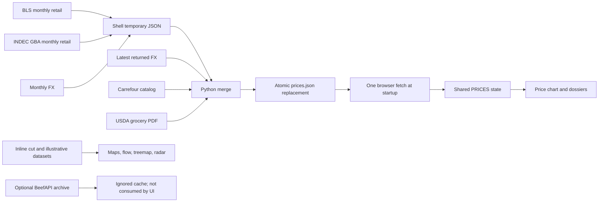

# Beef Chart professional market review

**Review date: October 9, 2026. Scope: Argentina and United States livestock, cattle, beef cuts, procurement and trade.** Beef Chart is a strong visual educational reference and a small retail-price snapshot application; it is not yet a dependable professional cattle-and-beef market workbench. Its paired cut explorer, bilingual names, source distinctions, missing-price handling and atomic snapshot writes provide a useful foundation. The main obstacles are inconsistent product and observation identities, overstated freshness and accessibility claims, several reproduced data and interaction defects, and the absence of history, physical-market benchmarks and reproducible decision workflows. The initial application working tree was clean; the review examined the six latest committed changes, not an uncommitted implementation diff. This report identifies **21 evidence-backed finding groups and 72 distinct correction/enhancement opportunities**, with proposed acceptance criteria and sequencing. The best direction is to preserve the educational explorer and add an accessible workbench with traceable evidence that connects a specified product to an eligible market observation and a saved procurement scenario. No application repair, live feed acceptance, deployment or professional release is claimed here.

## 1. A useful educational atlas now needs a market evidence contract

### The current inventory is small enough to understand completely

The application is a static site with no frontend build step. A **1,844-line `index.html`** combines layout, base CSS, cut registries, geometry, calculations, direct D3 initialization, event handlers and price loading. A 27-line dense override stylesheet supplies the current Bauhaus presentation. Ten WebP images support the editorial/gallery content. The price snapshot has 402 lines, and the refresh system consists of two shell scripts, one Python scraper and a unittest-compatible file with eight test methods. README, architecture, cut-guide, data-pipeline and roadmap documents explain the intended behavior. There is no checked-in historical store, formal schema, dependency manifest, CI workflow, deployment configuration or license document. These are observed repository facts, not evidence that a more complex stack is necessary. ([Application](/Users/ryanjohnson/Projects/beef-chart/index.html:1122), [architecture](/Users/ryanjohnson/Projects/beef-chart/docs/architecture.md:82), [tests](/Users/ryanjohnson/Projects/beef-chart/tests/test_retail_prices.py:19), [README](/Users/ryanjohnson/Projects/beef-chart/README.md:54))

The content contains **20 Argentine retail muscle-cut definitions, nine US primals, four specialty definitions and 12 comparison rows**. Its flow is editorial introduction, paired cow explorer, ground-beef benchmark and search, carcass-flow schematic, retail-price lollipop chart, value treemap, popular cuts and offal. A cut opens a culinary dossier, price evidence and heuristic radar. Six popular cards explicitly support keyboard activation. Accent-normalized lookup, synchronized highlighting and per-source price blocks are useful patterns to retain. A wholesale primal currently opens its first corresponding retail cut rather than a primal dossier; fixed arrows open ribeye or strip instead of navigating the user's selection. ([Registries](/Users/ryanjohnson/Projects/beef-chart/index.html:1133), [comparison rows](/Users/ryanjohnson/Projects/beef-chart/index.html:1199), [primal selection](/Users/ryanjohnson/Projects/beef-chart/index.html:1301), [arrow actions](/Users/ryanjohnson/Projects/beef-chart/index.html:1764))

The visual identity is an asset. The explorer makes unfamiliar names approachable, and the page already acknowledges loose comparisons and illustrative yield/value graphics. The appropriate evolution is a shared reference catalog plus a compact professional route, rather than replacing the site with a dense terminal everywhere. For Ryan, that route should support short spoken searches, persistent selections, an obvious resume point and complete table-based operation. Spanish cut names embedded in English pages are a starting point; they do not yet provide full Spanish operation, locale-correct dates or native currency/unit choices. ([Existing qualifications](/Users/ryanjohnson/Projects/beef-chart/index.html:981), [comparison note](/Users/ryanjohnson/Projects/beef-chart/index.html:1838), [locale](/Users/ryanjohnson/Projects/beef-chart/index.html:2))

### The lifecycle refreshes a snapshot, not a live market



`fetch-prices.sh` assembles BLS, INDEC and monthly FX observations into a temporary file. `scrape-retail.py` adds latest-returned FX, retailer listings and USDA grocery-feature PDF results before replacement. The browser makes one `fetch('data/prices.json')` at startup. It does not stream prices or automatically refresh an open view. The optional BeefAPI script archives metadata separately and does not source the page's glossary. ([Orchestrator](/Users/ryanjohnson/Projects/beef-chart/fetch-prices.sh:28), [merge](/Users/ryanjohnson/Projects/beef-chart/scrape-retail.py:193), [browser fetch](/Users/ryanjohnson/Projects/beef-chart/index.html:1841), [optional archive](/Users/ryanjohnson/Projects/beef-chart/fetch-beef.sh:2))

The checked snapshot contains **17 US and 19 Argentine records**. Its retrieval timestamp is October 7, while BLS/INDEC periods are August, USDA is October 2, Carrefour is October 7 and latest-returned FX is August 31. That FX observation precedes the catalog date by 37 days. Fifteen Argentine records omit the FX rate/date/basis now promised by documentation and UI. Offline arithmetic matches the stored conversions under an inferred monthly/daily basis within rounding tolerance; that supports arithmetic consistency, not provider authenticity, current availability or an appropriate conversion date. **There is no supported allegation of fabricated prices.** ([Snapshot](/Users/ryanjohnson/Projects/beef-chart/data/prices.json:2), [legacy record](/Users/ryanjohnson/Projects/beef-chart/data/prices.json:142), [FX](/Users/ryanjohnson/Projects/beef-chart/data/prices.json:386), [UI claim](/Users/ryanjohnson/Projects/beef-chart/index.html:1838))

### Git is locally synchronized; the six recent commits need reconciliation

Initial `main` was clean at **`bc27966f4ea2e9682532bbbb13126b198fba1e5b`**, with staged/unstaged diffs and preexisting untracked-file listing empty. Local `origin/main` matched it, with zero ahead and zero behind. The configured repository is [ryan258/beef-chart](https://github.com/ryan258/beef-chart). No fetch was performed, so this says nothing about changes on the live remote after the last local fetch. Research notes and this report are the review's new artifacts. The examined baseline was `98671ff`, preceding the six commits below. ([Git review evidence](</Users/ryanjohnson/Projects/beef-chart/research_notes/Beef market professional review/code_review.md>))

| Commit | Change and retained strengths | Review consequence |
|---|---|---|
| `6e001bf` | Five files, 685 insertions: pipeline, snapshot, optional enrichment and initial six tests; atomic writes and targeted filters are useful. | Older cuts retain weaker unit/species checks; prior-only USDA dating needs correction. |
| `7694cb3` | Thirteen files, 1,443 additions: guides, roadmap and GitNexus material improve orientation. | Real-time, complete keyboard, universal strict verification and validated-schema claims exceed evidence. |
| `38abaf3` | Four files, 46 additions/7 removals: generated per-record FX metadata and two USDA tests. | Existing snapshot is not fully migrated; top-level description incorrectly associates native-USD USDA data with daily FX; PDF/prior-only coverage remains weak. |
| `8b127a4` | Two files, 191 additions/37 removals: CDN fallback, missing-price formatting, modal focus/semantics, chart fallbacks and FX presentation. | Fatal top-level D3 dependency and modal/validation defects survive; improvements should be retained while repairing their incomplete lifecycle. |
| `fbcb024` | Documentation, 68 additions/74 removals: clearer naming, tokens and FX explanations. | Conformance, parsing coverage and yield/value assertions still require correction. |
| `bc27966` | Snapshot only, 110 additions/10 removals: three offal records and chorizo provenance. | All new offal are out of stock; they are legitimate catalog references, not executable offers. Fifteen other AR records remain without promised FX fields, `bife_costilla` remains absent and top-level retrieval time is retained. |

The graph index is at `fbcb024`, one commit behind HEAD. The wrapper hung in runner lookup; a cached CLI supplied a bounded graph review. Python ingestion impacts were structurally LOW, but inline frontend targets returned UNKNOWN/target-not-found. Baseline change analysis reported 20 files, 107 symbols, four flows and medium risk, with summarized output. **This is incomplete graph coverage, not a clean architectural all-clear; low call fanout does not reduce the economic impact of a wrong unit or date.** No reindex or full test suite ran. Exact commands and limitations are retained in the [code review notes](</Users/ryanjohnson/Projects/beef-chart/research_notes/Beef market professional review/code_review.md>).

## 2. Twenty-one finding groups identify concrete correction work

Priorities below reflect this project's accessibility and proposed professional use. **P1** means a correction before relying on the affected workflow; **P2** means a material quality/reliability correction; **P3** means polish or hardening. These are not claims that every proposed professional feature already belongs to the current app. “Reproduced” means a stated local browser or offline input demonstrated behavior; “source” means code/content inspection established the issue without a live-provider exercise.

| ID / priority | Evidence and practical effect | Concrete solution proposal |
|---|---|---|
| **F01 / P1** | Reproduced: older-cut matching accepts a `0.5 kg`, unit `un`, 10,000-ARS pack as 10,000 ARS/kg. It also accepts cooked lomo and inappropriate species descriptions. Four new keys have stronger checks, but a species blacklist is still insufficient. ([Checks](/Users/ryanjohnson/Projects/beef-chart/scrape-retail.py:68), [units](/Users/ryanjohnson/Projects/beef-chart/scrape-retail.py:85)) | One all-cut contract for supported bovine identity, raw/prepared state, quantity and sale unit; reject/quarantine unknown units, or normalize packs only with complete weight evidence. |
| **F02 / P1** | Reproduced path mapping: README's root `http.server` command serves existing `.env` and `.git/config` paths and lacks loopback binding. No credential contents were read or transmitted. ([Command](/Users/ryanjohnson/Projects/beef-chart/README.md:92), [secret input](/Users/ryanjohnson/Projects/beef-chart/fetch-beef.sh:9)) | Serve a generated whitelist directory containing public app files only; bind `127.0.0.1`. Verify artifact exclusion independently of `.gitignore`. |
| **F03 / P1** | Isolated browser reproduction: complete D3 loss throws at top-level `d3.select`, stopping price loading/search/fallback setup. Sankey-only failure also disables unrelated charts through the shared predicate. ([Loader](/Users/ryanjohnson/Projects/beef-chart/index.html:13), [startup](/Users/ryanjohnson/Projects/beef-chart/index.html:1247)) | Boot base tables/search/data without chart dependencies; gate each chart separately and pin local libraries. |
| **F04 / P1** | Browser reproduced: Escape removes `.open` through an earlier listener; later cleanup skips, leaving `aria-hidden=false` and focus inside the invisible modal. ([Earlier listener](/Users/ryanjohnson/Projects/beef-chart/index.html:1123), [canonical handler](/Users/ryanjohnson/Projects/beef-chart/index.html:1713)) | A single close lifecycle for Escape/button/backdrop; update state and restore initiating focus exactly once. |
| **F05 / P1** | Browser reproduced: standard-cut modal references `modal-cut-title` but does not insert that ID; specialty modal does. ([Dialog](/Users/ryanjohnson/Projects/beef-chart/index.html:1114), [standard title](/Users/ryanjohnson/Projects/beef-chart/index.html:1611)) | A stable named title for every modal/dossier type. |
| **F06 / P1** | Browser reproduced closed-dialog focusability; source shows opacity-only hiding and no background inert lifecycle. ([CSS](/Users/ryanjohnson/Projects/beef-chart/index.html:792), [trap](/Users/ryanjohnson/Projects/beef-chart/index.html:1715)) | Native dialog or explicit hidden/inert state; isolate background while open and remove closed controls from navigation. |
| **F07 / P1** | Runtime DOM: 29 cow paths have no keyboard target; pointer-only interactions and charts lack a complete text equivalent. Six accessible cards do not cover all cuts/primals. ([Cow events](/Users/ryanjohnson/Projects/beef-chart/index.html:1251), [treemap](/Users/ryanjohnson/Projects/beef-chart/index.html:1512)) | Complete searchable table/list first; keyboard selection, focus equivalents, chart descriptions and visible source evidence. |
| **F08 / P2** | Offline reproduction: prior-week-only USDA columns produce a value carrying the current report's date. ([Fallback](/Users/ryanjohnson/Projects/beef-chart/scrape-retail.py:155)) | Separate publication date from effective feature week; record fallback reason and the actual previous interval. |
| **F09 / P2** | Snapshot inventory: 15 of 19 AR records lack promised FX fields; latest-returned FX is 37 days older than catalog date. ([Legacy record](/Users/ryanjohnson/Projects/beef-chart/data/prices.json:142), [FX](/Users/ryanjohnson/Projects/beef-chart/data/prices.json:386)) | Versioned migration; preserve proved provenance, mark inferred legacy basis, display lag and require explicit as-of rules. |
| **F10 / P2** | Offline reproduction: successful zero-match targeted refresh deletes previous records while retaining old `fetched`; full refresh also clears nonmonthly records before merge. ([Clear/merge](/Users/ryanjohnson/Projects/beef-chart/scrape-retail.py:204)) | Mark current availability unavailable and log the attempt; retain immutable last-good observations separately with original age. Never carry them forward as current. |
| **F11 / P2** | Source: one catalog error can prevent healthy official-source results publishing through the all-or-nothing merge. Atomic replacement itself is valuable. ([Fetch order](/Users/ryanjohnson/Projects/beef-chart/scrape-retail.py:199), [coupling](/Users/ryanjohnson/Projects/beef-chart/fetch-prices.sh:66)) | Independent staged adapter results and health state, followed by validated atomic manifest promotion. |
| **F12 / P1** | Browser reproduced offal cards show numeric quotes without stock qualification; snapshot lists every associated offer out of stock. Modal does disclose status. ([Cards](/Users/ryanjohnson/Projects/beef-chart/index.html:1099), [fallback](/Users/ryanjohnson/Projects/beef-chart/scrape-retail.py:181), [records](/Users/ryanjohnson/Projects/beef-chart/data/prices.json:277)) | Consistent “unavailable; historical catalog reference” date/status at card/chart/modal/export; inactive values excluded from actionable views. |
| **F13 / P2** | Source: chart eligibility checks object existence, allowing null/malformed numeric values into scales; missing region structures can later be dereferenced. Fetch failure becomes silent null. ([Chart](/Users/ryanjohnson/Projects/beef-chart/index.html:1445), [lookup](/Users/ryanjohnson/Projects/beef-chart/index.html:1189), [fetch](/Users/ryanjohnson/Projects/beef-chart/index.html:1841)) | Central schema/positive-finite validation, explicit missing-FX native-only state and isolated renderer failure/retry messages. |
| **F14 / P1** | Content contradiction: cut guide calls entraña fina inside skirt; app says outside skirt. ([Guide](/Users/ryanjohnson/Projects/beef-chart/docs/cuts-guide.md:63), [registry](/Users/ryanjohnson/Projects/beef-chart/index.html:1152)) | Correct the guide and audit attached prices for actual muscle, membrane and preparation specification. |
| **F15 / P1** | Source/content: vacío→flank/bavette and matambre→flank flap imply excessive one-to-one equivalence; retailer names cannot establish procurement identity. ([Mappings](/Users/ryanjohnson/Projects/beef-chart/index.html:1141), [pairing](/Users/ryanjohnson/Projects/beef-chart/index.html:1205)) | Typed, sourced relationships: exact within qualifiers, partial anatomical overlap, culinary substitute or unknown. |
| **F16 / P2** | Arithmetic/content: nine primal shares total 100%, then flow adds 4% “other”; treemap is hardcoded retail-value shares despite yield documentation. Radar precision is an unlabeled heuristic. ([Flow](/Users/ryanjohnson/Projects/beef-chart/index.html:1364), [value](/Users/ryanjohnson/Projects/beef-chart/index.html:1495), [radar](/Users/ryanjohnson/Projects/beef-chart/index.html:1653)) | Reconcile denominator/mass balance; distinguish weight, saleable yield, value allocation and editorial sensory estimates. |
| **F17 / P2** | Source: search chooses first substring match on Enter/button, offers no ambiguous/no-result state and does not implement chart search; primal/arrows use fixed or first-item selection. ([Search](/Users/ryanjohnson/Projects/beef-chart/index.html:1730), [arrows](/Users/ryanjohnson/Projects/beef-chart/index.html:1764)) | Candidate list with bilingual aliases/spec codes and status; proper primal dossier/children and contextual previous/next controls. |
| **F18 / P2** | Bounded browser evidence: actual 500px viewport produced modal-content overflow; 320px was not achieved. Fixed grid/radar and small chart labels explain fragility. ([Grid](/Users/ryanjohnson/Projects/beef-chart/index.html:1616), [radar](/Users/ryanjohnson/Projects/beef-chart/index.html:1634)) | Responsive stack, readable chart-table alternative, zoom/reflow checks on actual small devices. |
| **F19 / P2** | Docs assert real-time, complete keyboard/WCAG acceptance, schema validation and a yield treemap without matching evidence; MIT is declared without LICENSE. ([README](/Users/ryanjohnson/Projects/beef-chart/README.md:15), [roadmap](/Users/ryanjohnson/Projects/beef-chart/roadmap.md:29), [schema claim](/Users/ryanjohnson/Projects/beef-chart/docs/data-pipeline.md:29)) | Separate implemented, verified and planned claims; reconcile method/runbook/catalog docs and license/asset provenance. |
| **F20 / P2–P3** | Source hardening gap, no observed exploit: external metadata reaches HTML interpolation; dependencies use mutable CDN aliases without hashes. ([Interpolation](/Users/ryanjohnson/Projects/beef-chart/index.html:1576), [tooltip](/Users/ryanjohnson/Projects/beef-chart/index.html:1549), [CDNs](/Users/ryanjohnson/Projects/beef-chart/index.html:10)) | Text nodes/safe links, validated strings, pinned local assets and a suitable content policy. |
| **F21 / P3** | Source: no bounded shell request policy or write lock, first-20-hit catalog retrieval/first seller, no coverage receipt/history; optional cache writes directly. ([Requests](/Users/ryanjohnson/Projects/beef-chart/fetch-prices.sh:30), [catalog](/Users/ryanjohnson/Projects/beef-chart/scrape-retail.py:174), [cache](/Users/ryanjohnson/Projects/beef-chart/fetch-beef.sh:20)) | Explicit budgets/backoff, coverage/seller context, freshness rules, concurrency protection and validated atomic cache/history handling. |

For F14, IPCVA identifies entraña fina as diaphragm; IMPS 121C outside skirt is diaphragm, whereas 121D inside skirt is transversus abdominis. This supports a qualified anatomical relationship, not assurance that an unspecified retailer's “skirt” is the matching item. IPCVA vacío includes multiple abdominal-wall muscles, so a narrow US flank specification cannot be assumed identical. Preserve bife de costilla, boneless strip/bife angosto and T-bone distinctions as separate identities. ([IPCVA entraña](https://ipcva.agrositio.com/nomenclador2015/cortes-detalle.php?categoria_id=6&corte_id=91), [IMPS Series 100, printed p. 41](https://www.ams.usda.gov/sites/default/files/media/IMPS_100_Fresh_Beef%5B1%5D.pdf), [IPCVA vacío](https://ipcva.agrositio.com/nomenclador2015/cortes-detalle.php?categoria_id=6&corte_id=82))

## 3. Professional value depends on comparable observations and accepted sources

### Separate the thing, the observation, and its calculation

The canonical catalog should identify species, animal category or cut, anatomy, bone/trim/membrane, packing, fresh/chilled/frozen state, grade and source-standard edition. Grade, breed, feeding claims and certification remain separate fields. Argentina's official carcass/category and meat-quality frameworks should retain their own identifiers; translating them directly into USDA quality grades would require evidence not established here. ([Resolution 32/2018](https://www.argentina.gob.ar/normativa/nacional/316048/texto), [official classification annex](https://www.argentina.gob.ar/normativa/330589_res195_pdf/archivo), [AMS procurement specifications](https://www.ams.usda.gov/grades-standards/imps))

An observation should then identify source/report/series and raw product description; market stage; location; currency/unit/weight basis; category/grade/specification; transaction, offer, reference or statistical average; effective interval; publication/retrieval times; sample count/volume and aggregation; availability, revision and receipt/parser version. A derived value references the exact observation, FX series/rate/date, conversion factors and calculation version. Liveweight cattle, dressed carcass, boxed beef, retail offers and trade quantities can appear in one workspace but remain different measurement stages. USDA mandatory reporting constructs defined cattle/beef reporting populations and exclusions; it is not a universal transaction universe. ([LMR explanation](https://www.ams.usda.gov/rules-regulations/mmr/lmr/compliance/FAQ), [excluded transactions](https://www.ams.usda.gov/rules-regulations/mmr/lmr/excluded-transactions))

A comparison returns **comparable, qualified approximation, or incompatible**, with the reasons visible beside the numbers. USD/lb conversion alone establishes neither muscle identity nor grade, tax, channel, geography or time equivalence. ERS farm/wholesale/retail spreads use standard-animal conversion factors; these are methodology assumptions, not measured yield promises or packer profits. Trade datasets also require care: ERS meat trade quantities use carcass-weight equivalent, which cannot silently serve as the denominator for a quoted saleable-cut price. ([ERS spread method](https://www.ers.usda.gov/data-products/meat-price-spreads/documentation), [ERS trade documentation](https://www.ers.usda.gov/data-products/livestock-and-meat-international-trade-data/documentation))

Current availability, refresh attempts and immutable observations need separate records. A successful empty catalog result means **current unavailable**, with an attempt timestamp and reason; its last-good evidence stays accessible with its original date. Parse error, suppression, no trading, no stock, unsupported item, blocked source and stale are different states. Out-of-stock catalog values can remain historical references with prominent status; they must not become current buying signals. A generated manifest should point to fresh accepted observations and explicitly aged references without erasing either history or failure evidence.

### The source registry distinguishes existing snapshots from proposed adapters

“Identified” below means an authoritative source product was inspected during research. It does **not** mean a working ingest adapter, accepted redistribution rights or a current price feed. No paid feed or authenticated API was exercised.

| Source / priority | Intended role and observed access | Acceptance still required |
|---|---|---|
| Existing BLS / INDEC retail | Current app's monthly consumer context, not cattle/wholesale benchmarks. INDEC GBA geography must survive. ([INDEC IPC](https://www.indec.gob.ar/Nivel4/Tema/3/5/31), [current registry](/Users/ryanjohnson/Projects/beef-chart/README.md:40)) | Raw receipts, exact series/coverage, revisions and source-level freshness. Existing snapshot is not a new live-provider acceptance. |
| Existing USDA grocery features | Advertised retail context; current PDF parser has dating/layout gaps. ([Parser](/Users/ryanjohnson/Projects/beef-chart/scrape-retail.py:155)) | Retained real-layout fixtures, proper column/week identities, weighting and publication/effective dates. |
| Existing Carrefour catalog | Retail offers/reference evidence; unavailable entries and unit/species matching require qualification. ([Matching](/Users/ryanjohnson/Projects/beef-chart/scrape-retail.py:71)) | Supported species/unit/spec, stock/offer date, seller/geography, coverage and terms; current external access unverified. |
| **P0 AMS LMR / MyMarketNews** | Official physical cattle and boxed-beef reporting; API documentation identifies authentication. ([Notices](https://mymarketnews.ams.usda.gov/LMR%20Public%20Notices), [API guide](https://mymarketnews.ams.usda.gov/mars-api/getting-started)) | Exact report IDs, real payload, qualifiers/confidentiality flags, cadence and rights; keep credentials outside public files. |
| **P0 AMS wholesale items** | Readable weekly individual-item report with grade/volume/weighted-price context. ([Report 2465](https://www.ams.usda.gov/mnreports/ams_2465.pdf)) | Confirm structured equivalent and required item coverage; reconcile one raw report to output before acceptance. |
| **P0 Argentina SIO Carnes** | Official portal links monitor/statistics/monthly reports; linked monitor timed out and some links returned 403 in this environment. ([Carnes portal](https://www.argentina.gob.ar/bioeconomia/mercados-agropecuarios-y-negociaciones-internacionales/carnes)) | Identify permitted downloads/API or documented manual import. Blocked is not missing market data and not authorization to bypass. |
| **P0 MAG** | Primary Cañuelas market data center offers category/price/head/index/history views. ([Data center](https://www.mercadoagroganadero.com.ar/dll/hacienda1.dll/haciinfo000001)) | Stable transport, sampling/history/rights; Cañuelas evidence cannot silently stand in for nationwide cattle. |
| **P0 BCRA** | Official API catalog and A3500/monthly-average FX products identified. ([API catalog](https://www.bcra.gob.ar/apis-banco-central/), [FX series](https://www.bcra.gob.ar/tipo-cambio-referencia-comunicacion-a-3500-tcnpm/)) | Exact series/version, live payload, limits and permissions; A3500 wholesale identity must not relabel the app's current proxy. |
| **P0 IPCVA / IMPS** | Authoritative anatomy and procurement references; IMPS includes Spanish material. ([IPCVA catalog](https://ipcva.agrositio.com/nomenclador2015/), [IMPS catalog](https://www.ams.usda.gov/grades-standards/imps)) | Edition, qualifiers and expert mapping review; public photographs/diagrams still require rights review. |
| **P1 ERS domestic / NASS** | Production, inventories, slaughter, cold storage and supply context; differing release frequencies and files. ([ERS domestic](https://www.ers.usda.gov/data-products/livestock-and-meat-domestic-data), [NASS Quick Stats](https://www.nass.usda.gov/Quick_Stats/)) | Exact variables/calendars, current schema fixtures and units; database update frequency is not statistic frequency. |
| **P1 ERS spreads / trade** | Standardized chain context and partner-country cattle/meat flows, with methodological conversions. ([Spreads](https://www.ers.usda.gov/data-products/meat-price-spreads), [trade](https://ers.usda.gov/data-products/livestock-and-meat-international-trade-data)) | Weight basis, classifications, revisions and conversion reconciliation; spreads are not realized business margin. |
| **P1 FAS GATS / PSD / GAIN** | Official trade, supply/distribution and country-report layer; open-data entry showed maintenance during review. ([Catalog](https://fas.usda.gov/data/databases-applications), [open-data entry](https://apps.fas.usda.gov/opendataweb/home)) | Current availability, commodity coverage, versions and access; published reports/manual imports remain a possible route. |
| **P1 Argentine fundamentals / INDEC trade** | Agriculture and SENASA starting points plus official merchandise-trade context; some pages blocked and historical pages contain older years. ([Ganadería](https://www.argentina.gob.ar/economia/agricultura/ganaderia), [SENASA history](https://www.argentina.gob.ar/node/268284), [INDEC trade](https://www.indec.gob.ar/indec/web/Nivel3-Tema-3-2)) | Validate current replacement series, provisional/revised flags and coverage; do not label old pages current. |
| **P2 BYMA FX** | MEP/CCL definitions offer separate financial FX context, with different settlement geography. ([Index definitions](https://www.byma.com.ar/en/newsroom/byma-introduces-two-new-indexes-for-the-argentine-market), [data products](https://www.byma.com.ar/en/products/productos-de-datos)) | Current methodology, daily-close history, permission and access; this supports FX research, not equities expansion. |
| **P2 CME cattle** | Distinct cattle futures instruments and official specifications identified. ([Live Cattle](https://www.cmegroup.com/markets/agriculture/livestock/live-cattle), [overview](https://www.cmegroup.com/education/lessons/live-cattle-product-overview)) | Exact contract rules/expiry/settlement, licensed quotes/history and accepted rights. No feed was obtained. |
| **P2 A3 Mercados** | Official market information and derivatives venue identified. ([Market information](https://a3mercados.com.ar/info-de-mercado)) | Current product listing/liquidity and rights; local cattle futures were not verified. |

The registry itself should record owner, source/report ID, transport, methodology/version, cadence/window, actual coverage, timezone, rights state, approved local/display/export use, quotas and health. Every accepted adapter needs a retained raw artifact, independently reconciled sample, missing/revised handling and reproducible transformations. CME distinguishes display, non-display, historical and other uses; delayed visibility does not establish permission to redistribute or export data. Code licensing, provider data rights and image rights require separate records. ([CME policy center](https://www.cmegroup.com/market-data/license-data/market-data-policy-education-center.html), [historical distribution policy](https://www.cmegroup.com/market-data/distributor/files/cme-group-data-licensing-policy-guidelines-historical-information-distribution.pdf))

### Four saved workflows give the data a practical purpose

The morning brief should restore a saved cattle/boxed-beef/FX watchlist, show changes since the last visit, reveal release dates and source failures, and support one short command to resume. The procurement lookup should accept Spanish/English aliases or standard codes, expose anatomy/preparation, and compare a saved supplier quote against an eligible benchmark while retaining expiry, quantity, packing, terms and evidence. The analyst view should provide dated native/converted trends, geography/category filters, release vintages, seasonality and properly aligned spreads. The carcass/landed-cost worksheet should preserve user assumptions, measured or explicit yield, byproduct credits, logistics, financing and sensitivity in an exportable calculation artifact.

For an ARS/kg price `p` and FX `r` ARS/USD, USD/kg is `p/r` and USD/lb is `(p/r) × 0.45359237`. US cwt explicitly means 100 lb. These unit conversions do not perform a liveweight-to-carcass conversion. If purchased weight is `W`, price `P`, saleable yield `y`, other costs `C` and byproduct credits `B`, effective saleable cost is `(W × P + C − B)/(W × y)`, with consistent units/currency and `0 < y ≤ 1`. Native values remain canonical; rounding occurs at presentation. FX regime, rate date and monthly-aggregation convention belong to the saved scenario, not a hidden universal “dollar” default. ([BCRA series](https://www.bcra.gob.ar/tipo-cambio-referencia-comunicacion-a-3500-tcnpm/), [BYMA definitions](https://www.byma.com.ar/en/newsroom/byma-introduces-two-new-indexes-for-the-argentine-market))

Trade-cost estimates also need independent feasibility states. Country opening does not establish a particular establishment's authorization; product/country/establishment eligibility, animal-health restrictions, certificates, customs code, tariff/quota date and entry requirements must be checked separately. The reviewed tariff notices demonstrate date/product-specific rules, not current quota availability or a shipment's liability. A completed cost calculation can coexist with unresolved regulatory prerequisites. ([SENASA authorization](https://www.argentina.gob.ar/senasa/exportaciones-importaciones-y-estadisticas/exportaciones-e-importaciones/habilitacion-de-destino-de-exportacion/habilitacion-de-destino-de-exportacion-productos-de-origen-animal), [FSIS imports](https://www.fsis.usda.gov/inspection/import-export/import-guidance), [USITC HTS](https://hts.usitc.gov/search?query=02013), [dated CBP notice](https://content.govdelivery.com/accounts/USDHSCBP/bulletins/4102a02?reqfrom=share))

## 4. Seventy-two opportunities form a bounded, acceptance-driven backlog

This is a comprehensive backlog, not a proposal to implement everything immediately. **P0** means a prerequisite for the professional data contract; P1 delivers core usable workflows; P2 follows once evidence is dependable; P3 is later polish. Dependencies use backlog IDs. Effort is an indicative implementation size for one experienced developer: **XS ≤1 day, S 1–2 days, M 3–5 days, L 1–3 weeks**. These estimates exclude blocked-source access, external review and licensing delays and are not commitments.

### Evidence and domain foundations

| ID / priority | Problem → solution | Dependency | Acceptance | Effort |
|---|---|---|---|---|
| 01 / P0 | Inconsistent record contract → versioned native-observation schema. | — | Types, identity, dates, units and statuses validated before publication. | M |
| 02 / P0 | Current/reference confusion → separate availability, attempts and last-good history. | 01 | Empty, failure and stale fixtures remain distinct; last-good never appears current. | M |
| 03 / P0 | Weak older-cut units → universal unit/pack-weight rules. | 01 | 0.5kg/unit and unknown-pack cases reject or normalize with evidence. | S |
| 04 / P0 | Species/preparation blacklist → positive supported identity and raw/prepared field. | 01 | Cooked, pork, goat and unknown-species fixtures quarantined. | S |
| 05 / P0 | Prior-only USDA dating → effective-week/publication separation. | 01 | Previous-column fixture retains previous interval and fallback reason. | S |
| 06 / P0 | Missing legacy FX fields → evidence-qualified migration. | 01 | Proved/inferred/unknown basis visible for all 19 existing AR records. | S |
| 07 / P0 | FX lag/as-of ambiguity → source/date/convention join policy. | 06 | Future-rate joins reject; lag and selected policy display beside value. | M |
| 08 / P0 | Hidden transformations → native values and exact conversion lineage. | 01,07 | Native → normalized → displayed values reproduce across views/export. | M |
| 09 / P0 | Forced comparison pairs → eligibility engine with reasons. | 01,12 | Incompatible stage/spec/time/basis blocked or explicitly qualified. | M |
| 10 / P0 | No formal source registry → versioned methods/access/rights/cadence register. | — | Each current/proposed adapter has status and approved-use fields. | S |
| 11 / P0 | Sources not receipted → raw artifact/hash/parser receipts. | 01,10 | Each accepted observation links to original retained evidence. | M |
| 12 / P0 | Retail names substitute for specifications → canonical bilingual cut registry. | 10 | Stable IDs, anatomy/preparation and sourced standard editions. | L |
| 13 / P0 | Entraña contradiction → consistent qualified outside-skirt mapping. | 12 | Guide/UI/matches agree; unspecified skirt remains unspecified. | S |
| 14 / P0 | Vacío/matambre and regional aliases overmatch → typed relationships. | 12 | Exact/partial/culinary/unknown relationships survive comparison/export. | M |
| 15 / P0 | Quality dimensions conflated → independent grade/category/breed/feeding/certification. | 12 | No automatic AR→US grade translation without evidence. | M |
| 16 / P0 | Weight stages missing → live/carcass/product/retail/CWE basis fields. | 01 | Unit conversion cannot silently change denominator basis. | S |
| 17 / P0 | Inactive catalog quotes look actionable → status-aware price eligibility. | 02 | Card/chart/modal/export consistently disclose unavailability/date. | S |
| 18 / P1 | No reproducible history → append-only observations with source revisions. | 01,11 | Original/revised vintages retrievable and saved views bind to vintage. | L |
| 19 / P1 | Generic “average” hides sampling → counts, volumes and aggregation metadata. | 01 | SKU medians/features/weighted transactions/statistical averages differ visibly. | M |
| 20 / P1 | Price age unclear → observation/publication/retrieval/validation indicators. | 01,10 | Recent fetch of old observation remains visibly old. | S |

### Accessible reference and workbench interaction

| ID / priority | Problem → solution | Dependency | Acceptance | Effort |
|---|---|---|---|---|
| 21 / P0 | Duplicate Escape cleanup → one canonical close lifecycle. | — | Escape/button/backdrop restore correct state and initiating focus. | XS |
| 22 / P0 | Missing dialog name → stable title association in all branches. | — | Every cut/primal/offal dossier exposes its visible name. | XS |
| 23 / P0 | Invisible focusable dialog → hidden/inert or native-dialog lifecycle. | 21,22 | Closed controls absent from navigation; open background isolated. | S |
| 24 / P0 | Whole app requires D3 → independent base boot/per-chart gates. | — | No-D3 and Sankey-only failure preserve search/prices/table. | M |
| 25 / P0 | Pointer-only full catalog → complete accessible text/table route. | 12,24 | Every cut/primary market row operable by keyboard without hovering. | M |
| 26 / P0 | Malformed numbers enter charts → central validation and renderer isolation. | 01,24 | Null/negative/nonfinite/region-missing cases cannot draw zero quotes/crash app. | S |
| 27 / P1 | First-match/no-feedback search → alias/code candidate results and status. | 12 | Ambiguous/no-result queries announce choices; accents preserved. | M |
| 28 / P1 | Spanish naming only → full EN/ES locale layer. | 12 | Controls, evidence, dates and numeric formats operate in both locales. | M |
| 29 / P1 | Fixed USD/lb → native currency and kg/lb/cwt selectors. | 08,16,28 | Same raw observation reconciles in every supported display. | M |
| 30 / P1 | Primal clicks open arbitrary child → primal dossiers and explicit child navigation. | 12 | Selection matches visible primal and preserves user's context. | S |
| 31 / P1 | Decorative/fixed arrows → contextual previous/next and honest navigation labels. | 30 | Arrows follow selected list; back restores selection. | S |
| 32 / P1 | Modal/chart overflow → responsive stack and table fallback. | 25 | Actual small-screen/zoom reflow preserves evidence and controls. | M |
| 33 / P1 | Hover-only/chart-color context → titles/descriptions/focus parity/text qualifiers. | 25 | Selection and source/date info available without pointer or color. | M |
| 34 / P1 | Hard to resume → persisted workspace and stable deep links. | 18,27 | One short command restores view, filters and snapshot/scenario IDs. | M |
| 35 / P1 | Long reconstruction effort → compact data route, quick commands and large targets. | 25,34 | Core lookup/compare/resume completes with minimal spoken/keyboard input. | M |
| 36 / P2 | Tooltip/animation/font fragility → viewport-safe tooltips, readable sizes and reduced-motion/local font fallbacks. | 32,33 | Zoom, reduced motion and missing fonts preserve usable evidence. | S |

### Architecture, documentation and operations

| ID / priority | Problem → solution | Dependency | Acceptance | Effort |
|---|---|---|---|---|
| 37 / P0 | Root server exposes private paths → public whitelist artifact + loopback default. | — | `.env`, `.git` and receipts excluded from serveable artifact. | S |
| 38 / P1 | Monolith mixes domain/rendering → small ES modules with canonical datasets. | 01,12,24 | Source mapping clear; same behavior preserved through bounded smoke checks. | L |
| 39 / P1 | One source failure blocks all → independent adapters and staged manifest promotion. | 02,10,11 | One failed source cannot prevent healthy-source advance or erase history. | L |
| 40 / P1 | Unbounded/opaque fetches → per-adapter timeout/retry/cache budgets. | 39 | Failures classified; unchanged reports skip needless retrieval. | M |
| 41 / P1 | Partial catalog coverage hidden → bounded pagination/count/seller/geography receipt. | 03,04,11 | Truncation and offer population visible beside aggregates. | M |
| 42 / P1 | Concurrent write/rollback gaps → lock or compare-and-swap plus manifest recovery. | 39 | Concurrent/failed promotion preserves valid artifact and history. | M |
| 43 / P1 | Mutable dependencies/unsafe strings → pinned assets, safe text/links and suitable policy. | 24,37 | Provider strings cannot inject markup; dependency identity reproducible. | M |
| 44 / P1 | Setup uncertain → minimal dependency/runtime manifest and private local launcher. | 37 | Fresh documented environment starts without global assumptions. | S |
| 45 / P1 | Tests miss real parser semantics → retained USDA layouts and meaningful fault fixtures. | 03–08,26,39 | Correct numeric columns/date selection and boundary failures asserted. | M |
| 46 / P1 | Docs overclaim → implemented/verified/planned ledger and honest methods/runbook. | 01–20 | Claims match named evidence/date; setup/failure/recovery steps usable. | M |
| 47 / P1 | Code/data/image rights unclear → LICENSE and provenance/use register. | 10 | Intended code license resolved; upstream asset/data permissions separate. | S–M |
| 48 / P2 | Competing CSS/dead helpers/heavy images → readable tokens, cleanup and asset dimensions/lazy loading. | 38 | Visual identity preserved; CSS source clear; layout shifts reduced. | M |

### Physical-market coverage and analytical research

| ID / priority | Problem → solution | Dependency | Acceptance | Effort |
|---|---|---|---|---|
| 49 / P1 | No US physical-cattle benchmark → accepted AMS cattle adapter. | 01,10,11,39 | Raw report/sample reconciles category, region, sale mechanism and time. | L |
| 50 / P1 | Wholesale benchmarks missing → accepted AMS cutout/item adapter. | 01,10,11,39 | Grade/item/volume/weighted-price definitions preserved; grocery features stay retail. | L |
| 51 / P1 | No Argentine cattle evidence → MAG and/or permitted SIO/manual adapter. | 01,10,11,39 | Market population/coverage explicit; blocked access stays blocked. | L |
| 52 / P1 | FX proxy unclear → direct named BCRA adapter. | 07,10,11,39 | Exact series/version/date matches official retained evidence. | M |
| 53 / P1 | Supply drivers missing → ERS/NASS fundamentals with release calendar. | 18,39 | Inventory/slaughter/production/cold-storage units and vintages preserved. | L |
| 54 / P1 | Argentine supply missing → validated faena/production/head-count series. | 18,39 | Current series, category and coverage independently reconciled. | L |
| 55 / P1 | Cross-border flows absent → ERS/FAS/INDEC trade views. | 16,18,39 | Codes/product weights/CWE/heads/revisions remain distinguishable. | L |
| 56 / P1 | Daily work has no saved brief → watchlists/change-since-visit/release view. | 34,49–55 | Brief restores automatically and explains exact evidence changes. | M |
| 57 / P1 | Charts lack compatible history → aligned-period trends and grade/region spreads. | 09,18,19 | Joins/coverage inspectable; gaps distinct from zero. | M |
| 58 / P2 | Nominal ARS hides inflation/FX → separately labeled real/native/FX scenarios. | 07,18,52 | Named CPI/base geography and FX convention survive export. | M |
| 59 / P2 | Economic spread labels need rules → chain-context and eligible quote-benchmark labels. | 09,16,57 | Retail medians/chain spreads never imply executable margin. | S |
| 60 / P1 | Coverage confidence unexplained → volume/suppression/unknown-attribute panel. | 19,20 | Evidence limits visible without invented confidence percentages. | M |
| 61 / P2 | User must repeatedly check releases → meaningful-change alerts/source-health notices. | 39,56 | Quiet when unchanged; revised/source-failure event links to evidence. | M |
| 62 / P1 | Research cannot be reproduced → provenance-rich CSV/JSON/print export. | 08,09,18,47 | Table/chart/export reconcile; native values, vintage and rights preserved. | M |

### Physical economics, trade and optional hedging

| ID / priority | Problem → solution | Dependency | Acceptance | Effort |
|---|---|---|---|---|
| 63 / P1 | Supplier offers lack recoverable context → private quote archive/manual import. | 12,18,34 | Spec, expiry, volume, terms and attachment retained; offers separate from transactions. | M |
| 64 / P1 | Yield/value/sensory graphics imply measurement → coherent labeled teaching model. | 12,16 | Mass denominator totals 100%; value/sensory assumptions clearly editorial. | S–M |
| 65 / P2 | No lot economics → saleable-cost/carcass/byproduct scenario. | 08,16,63,64 | Dimensional/mass checks pass; independent calculation reproduces costs. | L |
| 66 / P2 | Name-based substitutes → specification/processing/yield substitution worksheet. | 09,12,14,65 | Unknown overlaps/customer tolerances stay unresolved. | M |
| 67 / P2 | Cross-border rules flattened → versioned product/establishment/route rule registry. | 10,12,55 | Effective dates/sources and independent feasibility states visible. | L |
| 68 / P2 | Delivered cost opaque → landed-cost scenario and sensitivity/break-even. | 08,63,65,67 | No duplicated freight; cost complete can coexist with unknown eligibility. | L |
| 69 / P2 | Scenarios hard to review → immutable calculation/report artifacts. | 34,62,65,68 | Inputs, exclusions, versions and evidence allow independent reproduction. | M |
| 70 / P2 | Futures identities/rights absent → optional licensed contract/settlement layer. | 10,18,47 | Product/month/multiplier/delay/settlement/expiry/rights explicit. | L |
| 71 / P2 | Hedge charts can mislead → cash-basis/roll/exposure scenarios. | 09,16,70 | Roll method/residual weight/FX-country basis mismatch disclosed. | L |
| 72 / P1 | Professional/AT acceptance unproven → bounded outside workflow review. | 25,62,69 | Buyer, specification/trade specialist and keyboard/AT user reproduce a real scoped workflow; gaps recorded. | M + external |

These opportunities deliberately omit brokerage execution, a broad equities platform, generalized account infrastructure and commercial packaging. They can become relevant only through a later user decision. Cooking/editorial content can stay in the reference route, with fixed times and cultural absolutes qualified, sourced imagery matched to specifications, and recipe search labeled honestly. This is lower value than evidence corrections and should not delay the first reliable workbench.

## 5. A staged path produces a trustworthy tool without a premature rebuild

### The first implementation package should correct existing evidence and access

The first bounded package should cover **03–08, 17, 21–26, 37 and the corresponding documentation updates**, with a minimal versioned state contract from 01–02. It should fix all-cut unit/species/preparation rules and prior-week USDA dating; distinguish current unavailable from stored last-good references; identify missing/inferred FX provenance and visible lag; qualify inactive cards; secure serving; repair modal lifecycle; make base price/search behavior survive D3 loss; and reject invalid numeric chart values. A complete accessible cut list is needed, but wholesale feed expansion can wait. Correct the entraña documentation and 104% flow in the same reconciliation pass so the current reference does not retain known contradictions. This is several focused changes, not a promise that a large refactor is required first.

Acceptance should be concrete: the synthetic half-kilo pack cannot become a kilogram quote; prior-only USDA values retain the correct effective week; empty current results visibly become unavailable while dated last-good references remain retrievable; every existing AR record exposes proved/inferred/unknown FX; all close paths return focus; closed modal controls disappear from navigation; a terminal chart-library failure leaves searchable priced reference content; invalid price values never become zero; and the public artifact excludes secrets/repository internals. Targeted checks should accompany these behaviors once implementation is authorized.

### Later phases add capabilities only after their prerequisites hold

| Phase | Scope | Exit evidence |
|---|---|---|
| **A — Correct and reconcile** | First package above; honest README/roadmap; schema/status/provenance and safe serving. | Reproduced defects fixed with narrow checks; current snapshots qualified; accessible reference baseline. |
| **B — Trusted reference workbench** | Canonical catalog, typed equivalence, modules, EN/ES, units, tables, saved/deep-linked views, receipts and print/CSV. | One snapshot reconciles across dossier/table/chart/export; all cut/spec facts traceable or explicitly uncertain. |
| **C — Physical-market history** | Independent adapters, immutable history/revisions, AMS/MAG or SIO/BCRA first; then fundamentals/trade. | Each accepted source has raw sample reconciliation, method/rights/coverage, outage handling and exact dates; country gaps remain explicit. |
| **D — Saved procurement economics** | Supplier archive, measured/assumed yield, carcass balance, landed cost, versioned rule evidence and sensitivity. | Another person independently reproduces scenarios and identifies all unresolved eligibility/input assumptions. |
| **E — Optional advanced research** | Licensed futures, transparent cash basis/roll/exposure, quiet alerts and professional pilot refinements. | Contract/data rights and calculations accepted; distinct settlement/delay/country basis retained. |

The architecture can remain economical: source adapters produce native observations; validation accepts or quarantines them; raw receipts and a local append-only store retain history; derivations perform explicit FX/unit/calendar joins; a publisher emits validated public JSON/CSV plus manifest; small frontend modules consume those artifacts. A local SQLite store or similarly simple durable structure is a proposal, not a mandatory platform selection. Authentication/cloud storage becomes necessary only if the chosen usage requires private remote synchronization. Operational runbooks should explain source budgets, failure classification, rollback, retention and fresh-environment setup. Automatic commits/push/deploy are separate owner actions, even if an older roadmap proposes them.

### Verification supports the review, not a release claim

The review used source/document inspection, individual/baseline Git diffs, bounded stale graph queries, offline mocked-input probes and a local static-server browser smoke. Normal browser boot loaded D3, 29 cow paths and the $6.92 bundled US ground-beef benchmark. Checks reproduced standard modal naming/Escape/focus defects, unqualified offal cards, actual-500px overflow and simulated terminal D3 loss; the server and test tab were closed. Offline probes established legacy pack/species/preparation behavior, prior-only USDA dating, zero-match deletion/unchanged retrieval timestamp, missing FX inventory/arithmetic consistency and root-server private-path mapping. Production data were not rewritten, credentials were not read and no live refresh ran. ([Content evidence](</Users/ryanjohnson/Projects/beef-chart/research_notes/Beef market professional review/content_functionality.md>), [code evidence](</Users/ryanjohnson/Projects/beef-chart/research_notes/Beef market professional review/code_review.md>))

Existing tests cover useful matching/stock/conversion cases, but the weighted USDA case mocks the parser; the filtering fixture does not assert numeric columns and its purported prior-week fixture includes current-week values. A passing run of those tests would not resolve actual PDF-layout/date or real-provider validation. No full suite, graph reindex, production/browser/device matrix, screen-reader audit, physical anatomy/yield review, professional interview, trade shipment, license acceptance or current live exchange quote was established. Documentation should track those gaps rather than convert roadmap checkmarks into acceptance evidence.

For Ryan to run later from the project root, the existing suite command is below. It was **not run during this review**; focused implementation work should first run only the checks that meaningfully verify the changes.

```sh
PYTHONDONTWRITEBYTECODE=1 python3 -m unittest discover -s tests -v
```

If a graph refresh is useful after future code work, the documented owner-run command is:

```sh
node .gitnexus/run.cjs analyze --index-only
```

An exceptional version of Beef Chart will let a professional explain **what product a number describes, what source population it represents, when it applied, how it was transformed, and which assumptions separate it from a real purchase or shipment**. The visual explorer makes that evidence understandable; the saved workbench makes it recoverable. That combination offers a distinctive and achievable direction without pretending that more feeds or attractive charts alone establish professional reliability.
