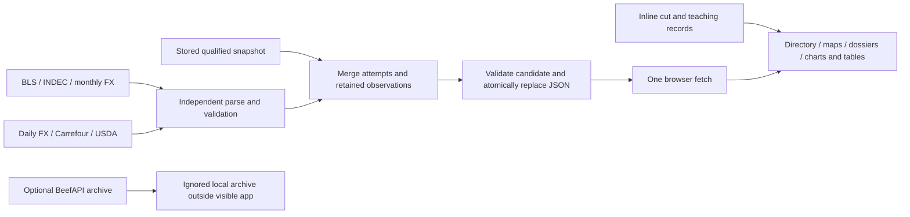

# Beef professional readiness review

**Comprehensive review and proposed action contract — October 14, 2026, America/Chicago. Reviewed revision: `012da49` on `main`.** Beef Chart has become a distinctive, substantially more truthful bilingual beef atlas with stored mixed-source retail context. Its recent work corrects many serious problems identified in earlier reviews: source failures are isolated, legacy evidence is qualified, unavailable organs are withheld, named native dialogs and keyboard-operable maps are verified in bounded Chromium checks, chart tables work independently of D3, and English/Rioplatense Spanish operation is implemented. It is **not yet an accepted commodity decision or teaching workbench**: all 36 stored observations are retail, original receipts and accepted real USDA fixtures are missing, product specifications and comparability are incomplete, and history, procurement economics, saved work and structured lessons remain proposed. The strongest direction is one shared evidence spine supporting three complete jobs: understand a product, explain a market number, and reproduce a saved purchasing or teaching decision. This report reviews the present system, its documentation and content, the 14-commit change series, bounded current verification, and **80 deduplicated correction/enhancement opportunities with solutions and acceptance criteria**. The inventory is comprehensive for the inspected beef/professional/educator scope; it does not imply that all future requirements have been elicited or that every proposal should be built.

## 1. A mature visual atlas now needs a professional evidence spine

### The current experience is useful and its boundaries are clearer

The application combines an editorial, vintage halftone/Bauhaus visual identity with **24 illustrated cut dossiers, 20 Argentine cut-map controls, nine U.S. primal-region controls, a full searchable directory, 12 contextual price-pair rows, three main diagrams with data tables, and editorial trait radar/table views**. Six popular cards and four specialty cards provide additional entry routes. It supports English and Rioplatense Spanish controls, search and locale formatting. This is a coherent reference experience, especially for someone learning unfamiliar names across the Argentine/U.S. divide. Its strongest existing behavior is refusing unsupported certainty: missing observations stay unavailable, some anatomical relationships are explicitly partial, and the three questionable organ observations remain withheld. ([Current application](/Users/ryanjohnson/Projects/beef-chart/index.html:850), [catalog](/Users/ryanjohnson/Projects/beef-chart/index.html:1161), [price rows](/Users/ryanjohnson/Projects/beef-chart/index.html:1339), [current architecture](/Users/ryanjohnson/Projects/beef-chart/docs/architecture.md:3))

The page fetches one bundled `data/prices.json` at startup. Browsing does not refresh providers, discover current supplier stock or stream commodity prices. The cow diagrams are schematic navigation; their shapes do not certify dissection boundaries. The flow uses **100 illustrative teaching units**; the treemap is a fixed illustrative allocation of value; the radar derives editorial scores, largely from broad preparation categories. Those are now honestly labeled and backed by tables, a major improvement over the earlier contradictory 104% flow and yield/value language. They remain explanatory demonstrations, rather than measured carcass fabrication, current valuation or sensory experiments. ([Price lifecycle](/Users/ryanjohnson/Projects/beef-chart/index.html:1988), [diagram explanations](/Users/ryanjohnson/Projects/beef-chart/index.html:1010), [shared flow model](/Users/ryanjohnson/Projects/beef-chart/index.html:1460), [radar formulas](/Users/ryanjohnson/Projects/beef-chart/index.html:1793))

The practical readiness distinction is therefore precise. The atlas is useful for exploration and qualified terminology reference. The price material supplies dated retail context with explicit limitations. A professional can use that context to ask better questions, but cannot yet recover a complete product specification, accepted contemporaneous benchmark, quote comparison or independently reproducible cost decision. An educator can demonstrate the page, but does not yet receive reviewed objectives, a frozen lesson dataset, answer keys, accessible assessment or classroom handouts. These are missing task capabilities, not proof that the existing atlas is defective.

### The zero-build architecture remains economical

Most presentation, canonical arrays, geometry, events and rendering remain in a **2,081-line `index.html`**. `assets/bauhaus.css` supplies layered overrides; `assets/i18n.js` provides a substantial Spanish catalog, interpolation and locale helpers. The Python ingestion uses the standard library, plus external PDF extraction where required. This architecture is small enough to understand end to end, but parallel maps for cut relationships, aliases, images, featured-card attributes and price rows already create drift opportunities. A modest extraction of domain records, state, validation, messages and rendering is justified by the next capabilities; a new framework, backend service or account system is not a prerequisite. ([Application records](/Users/ryanjohnson/Projects/beef-chart/index.html:1161), [parallel relationships/images](/Users/ryanjohnson/Projects/beef-chart/index.html:1203), [translation helpers](/Users/ryanjohnson/Projects/beef-chart/assets/i18n.js:326), [current module boundary explanation](/Users/ryanjohnson/Projects/beef-chart/docs/architecture.md:3))

| Owning file or area | Present responsibility | Consequence for future work |
|---|---|---|
| [index.html](/Users/ryanjohnson/Projects/beef-chart/index.html:1161) | Cut/primal records, schematic geometry, series mappings, UI state, search, dialogs, chart/table rendering and loading | Canonical product facts and application behavior are coupled; shared records should generate cards, dossiers and comparison rows. |
| [assets/i18n.js](/Users/ryanjohnson/Projects/beef-chart/assets/i18n.js:326) and [bauhaus.css](/Users/ryanjohnson/Projects/beef-chart/assets/bauhaus.css:88) | Bilingual operation, formatting and visual overrides | Preserve behavior while introducing stable message IDs and readable style ownership. |
| [fetch-prices.sh](/Users/ryanjohnson/Projects/beef-chart/fetch-prices.sh:1) | Five-line entry point invoking Python with `--official` | Keep a short operator command; document that selected-cut wrapper runs still attempt official sources. |
| [official_prices.py](/Users/ryanjohnson/Projects/beef-chart/official_prices.py:10) | BLS, INDEC and monthly FX parsing and independent official-group merge | Keep source population, monthly joins and native-only retention explicit. |
| [scrape-retail.py](/Users/ryanjohnson/Projects/beef-chart/scrape-retail.py:270) | Daily FX, Carrefour sampling, USDA PDF parsing, orchestration and final promotion | Separate native acquisition, derived conversion and latest-selection rules before source expansion. |
| [price_contract.py](/Users/ryanjohnson/Projects/beef-chart/price_contract.py:29) | Legacy qualification, candidate validation, one previous record and atomic snapshot output | Extend semantic validation and identity/history without fabricating missing legacy evidence. |
| [serve.sh](/Users/ryanjohnson/Projects/beef-chart/serve.sh:1) | Copies an allowlisted public tree and serves it on loopback | Valuable private/public boundary; restart preview after edits because the tree is copied. |
| [fetch-beef.sh](/Users/ryanjohnson/Projects/beef-chart/fetch-beef.sh:1) | Optional credentialed archival importer, unused by the visible catalog | Its cache and path behavior need hardening before renewed use; it is not a current UI dependency. |
| [tests](/Users/ryanjohnson/Projects/beef-chart/tests/test_refresh_harmony.py:20), [docs](/Users/ryanjohnson/Projects/beef-chart/docs/architecture.md:1), [roadmap](/Users/ryanjohnson/Projects/beef-chart/roadmap.md:1) | Offline contract/regression checks, explanations and dated implementation evidence | Keep software checks separate from actual provider, expert, device, rights and classroom acceptance. |

The full refresh loads and qualifies the stored snapshot, obtains BLS/monthly FX/INDEC independently, validates and merges each official group, obtains daily FX, processes configured Carrefour cuts independently, parses USDA, and validates the final candidate before same-directory atomic replacement. A source failure can produce a nonzero process exit **after healthy results have been saved**. That is deliberate partial-success behavior, and operator output must make it easy to understand. `--official-snapshot` substitutes staged official input only; it still permits retail network requests and is explicitly **not an offline mode**. Direct scraper `--cuts` skips USDA and leaves monthly official groups alone, while the shell wrapper adds official attempts. ([Official staging/merge](/Users/ryanjohnson/Projects/beef-chart/official_prices.py:123), [retail orchestration](/Users/ryanjohnson/Projects/beef-chart/scrape-retail.py:270), [atomic writer](/Users/ryanjohnson/Projects/beef-chart/price_contract.py:153), [operator contract](/Users/ryanjohnson/Projects/beef-chart/docs/data-pipeline.md))

This is still a replacement snapshot with one retained predecessor per changed observation. It has no append-only receipt/history store, run database or concurrent-write lock. Atomic replacement prevents a torn file; it does not prevent two refresh processes from overwriting each other's changes. The sensible target architecture keeps the static read layer: source adapters produce native observations; validation accepts or quarantines them; immutable receipts and revisions retain evidence; explicit derivations join FX/units/calendar periods; a publisher emits a validated public manifest; small frontend modules render reference, market and teaching views. A local file archive or SQLite store is a decision to make from query needs, not a mandatory platform purchase. ([Qualification/merge](/Users/ryanjohnson/Projects/beef-chart/price_contract.py:29), [previous-record retention](/Users/ryanjohnson/Projects/beef-chart/price_contract.py:132), [documented current limits](/Users/ryanjohnson/Projects/beef-chart/docs/architecture.md:47))

### The snapshot contains 36 retail observations with heterogeneous dates

**Every current observation is retail stage.** There are 17 U.S. and 19 Argentine observations: six BLS, 11 USDA grocery-feature, five INDEC and 14 Carrefour. The configured scraper basket is larger than the stored catalog population: 17 Carrefour keys are configured, while only 14 currently have stored observations. Configuration coverage, successful retrieval, display eligibility and purchasing availability are different counts. ([Snapshot](/Users/ryanjohnson/Projects/beef-chart/data/prices.json:2), [source configuration](/Users/ryanjohnson/Projects/beef-chart/scrape-retail.py:27))

| Stored population | Count | Economic date in snapshot | Interpretation on October 14, 2026 |
|---|---:|---|---|
| BLS retail averages | 6 | August 2026 | Monthly statistical price context; not October offers. |
| USDA grocery features | 11 | October 2 report label | Twelve days old; legacy layout and effective-feature interval remain unverified. |
| INDEC IPC-GBA selected prices | 5 | August 2026 | Greater Buenos Aires retail context; not Argentine national wholesale coverage. |
| Carrefour catalog observations | 14 | October 7 | Seven days old; legacy stock/receipt limits apply; three organs withheld. |
| Daily FX, separate from prices | — | August 31 | **44 days old**, and 37 days older than the catalog observations. |

The legacy top-level `fetched` is October 7 at 19:51:30Z. `generated_at` is October 12 at 17:26:02Z and records metadata qualification, **not refreshed economic observations**. No current record has a known `retrieved_at`; four retain selected listing summaries, not complete original receipts. Fifteen Argentine records gained reconstructed rate/date qualifiers marked `inferred_from_legacy_snapshot`. These improvements make uncertainty more visible, but cannot turn an inference into an original provider receipt. ([Qualification note](/Users/ryanjohnson/Projects/beef-chart/data/prices.json:805), [FX metadata](/Users/ryanjohnson/Projects/beef-chart/data/prices.json:786), [pipeline contract](/Users/ryanjohnson/Projects/beef-chart/docs/data-pipeline.md))

All **19 Argentine USD conversions reconcile** to the retained native amount and rate within half-cent rounding; the largest residual is approximately $0.00484/lb for tongue. There is no demonstrated conversion-arithmetic explanation for the low organ prices. Molleja, riñón and lengua preserve their original amounts and out-of-stock listing evidence, with `unit_scale_unverified: true`; display rules withhold them. The original sale-unit basis remains unresolved. Preserve that quarantine until original supplier/listing evidence supports a qualification decision; **do not guess a ×10 rescale**. Absence of that flag elsewhere is also not positive proof of unit certification. ([Molleja](/Users/ryanjohnson/Projects/beef-chart/data/prices.json:636), [riñón](/Users/ryanjohnson/Projects/beef-chart/data/prices.json:670), [lengua](/Users/ryanjohnson/Projects/beef-chart/data/prices.json:704), [qualification method](/Users/ryanjohnson/Projects/beef-chart/docs/data-pipeline.md))

The common display unit USD/lb does not erase source differences. BLS average food prices exclude sales tax and can change with sample rotation, quality and consumer preferences; they are distinct from CPI inflation indexes. Grocery features are advertised consumer prices, not realized national transactions. INDEC average-price geography must remain attached to the selected series. Carrefour medians describe a bounded retailer sample: the first 20 products per alias and first seller per SKU, with deduplication and strict raw/bovine/per-kilogram filtering. A conservative no-match can be correct. None of these populations establishes a like-for-like, executable cross-border purchasing spread. ([BLS methodology](https://www.bls.gov/cpi/factsheets/average-prices.htm), [AMS grocery features](https://www.ams.usda.gov/market-news/grocerystore), [AMS retail terms](https://www.ams.usda.gov/market-news/livestock-poultry-and-grain-retail-terms), [INDEC portal](https://www.indec.gob.ar/Nivel4/Tema/3/5/31), [catalog sampling](/Users/ryanjohnson/Projects/beef-chart/scrape-retail.py:215))

## 2. Fourteen commits repair foundations without refreshing market evidence

### There was no dirty implementation patch when this review began

The repository entered review **clean on `main` at `012da49b398d3169a816d82a26618c730e115422`**, equal to the locally stored `origin/main`. Staged and unstaged diffs, untracked inventory, diff whitespace checks, submodule status and gitlink inventory were empty; no submodules exist. No fetch was performed, so current network remote synchronization is unknown. The changes authored by this review are its research notes and this report. They are review artifacts, not an implemented remediation patch, and are left unstaged/uncommitted. This distinction matters because the earlier reviews describe work that was uncommitted at their own dates but is now present in committed history. ([Current Git research](</Users/ryanjohnson/Projects/beef-chart/research_notes/Beef professional readiness review/market_git.md>))

The deep change review compared current HEAD against `bc27966`, the earlier organ-data commit, and inspected the recent behavior-bearing changes. That range contains **14 commits, 65 changed files, 5,356 insertions and 1,067 deletions**, plus illustration binaries. It is an explicit historical comparison, not a claim about an uncommitted diff, current remote changes or a freshly fetched merge base.

| Commit or group | Concrete change | Review judgment and residual boundary |
|---|---|---|
| `cf9b708` | Earlier reviews and notes | Useful dated evidence; fixed historical findings must not be recycled as current bugs. |
| `7f32cce` | v2 contract, qualification, stricter parsing and recovery | Real improvement in unit/species/form rules, validation and retained evidence; semantic contract still has gaps. |
| `ee832cf` | Native dialogs, accessible tables/maps, loopback launcher and withholding | Repairs core access/private-serving problems; human AT/device acceptance remains open. |
| `4c9b3af`, `3398aca` | Documentation reconciliation | Brings implementation, examples and boundaries closer together. |
| `b6366e6` | Independent official-source refresh | Healthy official groups can advance independently; missing matched monthly FX preserves native INDEC observations. |
| `f42c441` | Bounded catalog sampling evidence | Counts, deduplication and selected population are more inspectable; not a complete retailer census. |
| `0d5deb0`, `7b89825` | All-cut halftone dossiers and cut-paper map artwork | Strong visual coherence and provenance notes; geometry/art is still schematic and specialist/rights acceptance is separate. |
| `770fbb3`, `509554c` | Bilingual operation and documentation | Substantial functional gain; canonical data stayed semantically stable in the localization commit. |
| `8aa47ad` | Retail transport, batch and health isolation | Handles HTTP exceptions, closes responses, validates batches and preserves healthy results; no new credential or destination scope. |
| `bb17f4f` | Bilingual search, header offsets, loading, formatting and dossier mappings | Useful lifecycle corrections; native Enter defaults still bypass intended ambiguity choice. |
| `012da49` | Final documentation reconciliation | Correctly records current limits; it does not establish professional acceptance or refresh prices. |

The semantic preservation checks are more informative than diff volume. Both baseline and current snapshots contain 17 U.S. and 19 Argentine observations. **Original USD/lb, ARS/kg, observation periods, previous values and listing arrays are unchanged.** The data patch qualifies evidence; it does not refresh its economic content. Historical canonical arrays were evaluated in a bounded VM and compared by record identity, series, descriptions, scores, teaching shares and geometry. The map-redraw commit changes geometry without changing non-geometry canonical records. The bilingual commit changes none of those arrays. These results support the stated presentation/localization boundaries without claiming that every anatomical assertion is correct. ([Current records](/Users/ryanjohnson/Projects/beef-chart/index.html:1161), [snapshot](/Users/ryanjohnson/Projects/beef-chart/data/prices.json), [comparison method/results](</Users/ryanjohnson/Projects/beef-chart/research_notes/Beef professional readiness review/market_git.md>))

The deliberate domain corrections are narrow and valuable: matambre is now a superficial cutaneous-muscle reference, vacío has a partial flank relationship, generic skirt pricing remains unresolved for entraña, nalga loses an authenticity absolute, molleja is gland-unspecified, and Pecho/Cuadrada have their own Argentine series keys. Scores, preparation categories, record IDs and primal teaching shares otherwise remain stable. This is evidence of controlled scope, not a completed professional taxonomy. ([Catalog/relationships](/Users/ryanjohnson/Projects/beef-chart/index.html:1161), [cut guide](/Users/ryanjohnson/Projects/beef-chart/docs/cuts-guide.md:23))

### Current verified positives supersede several older defect lists

The named native `dialog` now isolates background content in the checked Chromium accessibility tree. All 29 map buttons have names. The full directory and price tables work independently of D3, and Sankey has its own dependency guard. Loading, ready and unavailable states are distinct; refreshing an open dossier restores recreated-control focus and scroll. At 320 CSS pixels, main chart table readers opened automatically, the page remained 320 pixels wide, and all 24 immediate dossier checks had matching card client/scroll widths of 294 pixels. All 24 mapped illustrations decoded as 1024×1024 images in separate checks; the representative Vacío dossier was visually readable with its close control present. These observations materially improve the earlier clipping, missing-name and pointer-only findings. ([Native dialog](/Users/ryanjohnson/Projects/beef-chart/index.html:1144), [map controls](/Users/ryanjohnson/Projects/beef-chart/index.html:1419), [reader behavior](/Users/ryanjohnson/Projects/beef-chart/index.html:2046), [active-dossier restoration](/Users/ryanjohnson/Projects/beef-chart/index.html:2018))

The current bounded checks passed **15 selected Python tests and 13 selected Node tests**. Python covered refresh isolation plus representative official-FX, atomic-write, prior-interval and sampling behavior. Node covered language and recent UI contracts. These are selected local checks, not a full suite or a live-provider acceptance record. Older TRUTH-HARMONY totals are historical, revision-specific evidence and are not added to current counts. Browser checks used an owned copied allowlist preview, desktop width 1200 and mobile/touch emulation 320×800. No console audit, screen-reader trial, Safari/Firefox matrix, physical device, zoom/text-spacing/forced-colors audit, print/cold-offline acceptance, production acceptance or professional field trial was performed. ([Current verification notes](</Users/ryanjohnson/Projects/beef-chart/research_notes/Beef professional readiness review/code_pipeline.md>), [browser/test scope](</Users/ryanjohnson/Projects/beef-chart/research_notes/Beef professional readiness review/content_experience.md>), [historical evidence ledger](/Users/ryanjohnson/Projects/beef-chart/docs/TRUTH-HARMONY.md:177))

GitNexus status/query attempts stalled; bounded graph queries returned no usable result. **Graph evidence remains unresolved**, not low risk or an empty dependency set. No analyze/reindex was run. Source inspection, deterministic probes and runtime observations support the specific findings in this report; they do not satisfy a future pre-edit graph-impact requirement. Restore the normal graph path or resolve the applicable project requirement before editing symbols. No full suite, live refresh, provider credential exercise, application source change, staging, commit, push, deployment or publication was performed in this review.

## 3. Product identity and evidence determine professional and teaching value

### Specifications must describe products more precisely than common names

The current record IDs, relationship cautions and direct references are a useful base. Only six cuts have tailored relationship objects; most receive a generic unreviewed terminology warning, and three tailored relationships contain direct reference links. Neither a warning nor a translated `eq` name replaces a reviewed purchasing specification. The target catalog should separate species, muscle/boundary, organ/gland, cut form, bone, membrane, fat trim, portion dimensions, chilled/frozen state, origin and named standard/edition. Grade, breed, production claim, aging and certification belong in separate fields. Unknown attributes stay unknown. USDA IMPS are voluntary purchasing specifications, with separate Fresh Beef 100 and Variety Meats 700 documents; published versions and drafts must not be conflated. ([Relationships](/Users/ryanjohnson/Projects/beef-chart/index.html:1203), [USDA IMPS index](https://www.ams.usda.gov/grades-standards/imps), [AMS beef standards](https://www.ams.usda.gov/grades-standards/beef))

The Argentine guide appropriately cites the original 1999 SENASA nomenclador and avoids claiming review of every later amendment. Keep namespaces and editions explicit. Cross-country relationships need their own evidence and direction: exact within a specified preparation, partial anatomical overlap, broad-primal context, regional term, culinary substitute or unresolved. A culinary substitute can be useful without meeting a buyer's specification. Vacío/flank, matambre, skirt variants and costilla/boneless-strip/T-bone make excellent reviewed teaching cases precisely because names fail to establish equivalence. ([Current guide](/Users/ryanjohnson/Projects/beef-chart/docs/cuts-guide.md:19), [original SENASA text](https://www.argentina.gob.ar/normativa/nacional/resoluci%C3%B3n-1128-1999-60581/texto))

Broad copy still merits domain review: paleta “yields the prized flat iron,” lomo “the tenderest muscle,” and “Flank steak and bavette” in regional descriptions. Hard-coded tenderness/marbling decimals and preparation-derived flavor/speed/sear/gelatin values remain editorial. They are now labeled honestly, but precise graphics can still suggest stronger measurement than exists. Replace them with reviewed practical traits/ranges, or keep them as an inspectable lesson about assumptions. Quality grade, yield grade, fabrication yield and cooked yield must remain different concepts. ([Catalog/primals](/Users/ryanjohnson/Projects/beef-chart/index.html:1161), [trait formulas](/Users/ryanjohnson/Projects/beef-chart/index.html:1797), [USDA carcass-grade standard](https://www.ams.usda.gov/sites/default/files/media/CarcassBeefStandard.pdf))

The artwork documentation is unusually useful: it records all 24 mappings, 27 cut WebPs with three intentional alias pairs, prompts, generation/reference use, conversion settings and bounded display checks. It also acknowledges missing earliest prompts and that some generations used former photographs as composition/subject references. This is a provenance start, not independent anatomical approval or a complete rights chain. Each illustration should identify its product form, simplification and review status; a whole muscle, retail steak and bone-in preparation can share a nickname while depicting different orderable products. Resolve code licensing separately from data, generated/derived images, reference photos, dependencies and trademarks. No tracked LICENSE or completed rights manifest was found. Absence of evidence is not a finding of infringement. ([Artwork record](/Users/ryanjohnson/Projects/beef-chart/docs/artwork-prompts.md:3), [reference-image use](/Users/ryanjohnson/Projects/beef-chart/docs/artwork-prompts.md:158), [README rights disclosure](/Users/ryanjohnson/Projects/beef-chart/README.md:167), [USDA rights policy](https://www.usda.gov/about-usda/policies-and-links))

### A market number needs a source population before it needs another chart

A professional observation should retain immutable native amount, currency/unit and weight basis; source/report/item identity; geography; product specifications; aggregation and sample/volume; observation/effective window, publication, retrieval and revision dates; availability; receipt hash/parser version; and transformation lineage. Normalization should record the exact FX observation and formula. Liveweight, carcass, product, retail-equivalent and carcass-weight-equivalent denominators are separate dimensions: changing lb to kg cannot change one into another. Comparability should be declared before computing percentage differences or spreads.

USDA AMS offers distinct cattle, boxed-beef, trimming, variety-meat and byproduct reports. The cutout is an **estimated gross carcass value**, using defined item prices and yields; it is not an invoice or processor profit. Daily boxed-beef reports preserve grade, delivery/report window, FOB basis and USD/cwt; cumulative PM and AM windows cannot simply be added. MyMarketNews API documentation requires registration/personal keys and does not support open browser calls, so any new adapter needs a deliberate local/server-side secret boundary or permitted public-file/manual-import route. ([AMS daily directory](https://www.ams.usda.gov/market-news/daily-beef-reports), [weekly/monthly directory](https://www.ams.usda.gov/market-news/weekly-and-monthly-beef-reports), [January 2026 cutout guide](https://www.ams.usda.gov/sites/default/files/media/LMRBoxedBeefCutoutsUserGuide.pdf), [MMN instructions](https://mymarketnews.ams.usda.gov/mars-api/getting-started/basic-instructions))

For Argentina, official ganadería/SIO links establish candidate sources, not an accepted feed, schema, license or reconciled transaction. A scoped source/manual import can be valuable while national coverage remains unknown. BCRA offers named A3500/nominal monthly-average history and an API directory; “official dollar” is insufficient lineage. Trade adds another denominator: ERS meat flows use carcass-weight equivalence, whereas live cattle stay in heads. The September 2026 ERS format change also illustrates why release/schema vintages matter. These sources should be added one accepted basket at a time, after receipts, method and allowed use are understood. ([Argentina ganadería](https://www.argentina.gob.ar/economia/agricultura/ganaderia), [SIO Carnes](https://siocarnes.magyp.gob.ar/), [BCRA history](https://www.bcra.gob.ar/tipo-cambio-referencia-comunicacion-a-3500-tcnpm/), [BCRA APIs](https://www.bcra.gob.ar/apis-banco-central/), [ERS trade](https://www.ers.usda.gov/data-products/livestock-and-meat-international-trade-data))

### Two complete journeys can share the same trusted records

The professional flagship should be **specify → compare qualified offers → calculate usable cost → save/export → resume**. Start with manual private quotes: supplier/location, valid time, product form/spec, quantity, packaging, currency/unit, availability, delivery/payment/tax terms and attachment. Public benchmarks remain context beside those offers. For consistent units and currency, purchased mass `W`, price per purchased mass `P`, applicable allocated costs `C`, byproduct credits `B` and saleable fraction `y`, a proposed usable-cost model is `(W × P + C − B)/(W × y)`, with `0 < y ≤ 1`. Measured and assumed yields stay distinct; cooking loss is a separate stage; margin and markup use different denominators. An independent buyer should reproduce one saved decision before the feature is described as professionally accepted.

The educator flagship should be **choose a learning objective → inspect a reviewed product/relationship → critique source evidence → change an explicit assumption → complete an accessible activity → reuse the frozen lesson**. A six-module sequence can cover anatomy/names, specifications/grades, source literacy, units/FX, yield/value and supply/trade. Known ambiguities become activities rather than false synonym drills. Every module needs objectives, prerequisites, one worked example, references, instructor notes and an assessable outcome. Synthetic practice data must be identified independently from actual historical observations, with accessible answer keys. A teacher delivering one complete lesson and learners explaining the reasoning provide evidence that screenshots and tests cannot.

Ryan's low-input access and recovery needs apply across both journeys. The current app saves language, but no selected cut, task, quote, filters or scenario; dossier opening does not create a URL/history entry. Stable links, recent/favorite cuts, saved units/views and one-action resume have immediate value without cloud accounts. Keep diagrams optional: directory, concise source summaries and keyboard-operable tables should carry the complete task. Product-aware preparation/safety references can support teaching, but do not infer one universal process from a cut name or generic recipe search. The guide already contains richer preparation/source cautions than the app exposes. ([Dossier state](/Users/ryanjohnson/Projects/beef-chart/index.html:1741), [language state](/Users/ryanjohnson/Projects/beef-chart/index.html:2054), [preparation references](/Users/ryanjohnson/Projects/beef-chart/docs/cuts-guide.md:41))

## 4. Eighty opportunities form a bounded action register

The following proposals consolidate current notes and earlier research while removing fixed defects and duplicate requests: **12 corrections and 68 enhancements/readiness items**. **C** means a correction to an existing behavior, contract or misleading route; **E** means enhancement, hardening or readiness acceptance. P1 means immediate access correction or a prerequisite before claiming a professional/teaching capability accepted; P2 means the next substantive capability or integrity correction; P3 means later optimization/optional breadth. **No P0 emergency is established.** S/M/L indicate relative implementation scope; specialist, rights, source-access and human review are additional dependencies. Dependencies refer to these stable `R01–R80` IDs; “existing” means the current architecture is sufficient to begin. Readiness priority is not a claim of a current production incident.

### Access, task state and reference presentation

| ID · type · priority | Opportunity and concrete solution | Depends / effort | Observable acceptance |
|---|---|---|---|
| R01 · C · P1 | **Ambiguous Enter opens the first result.** Prevent Enter's default before search changes focus; preserve an explicit candidate choice. | Existing / S | In actual browser input, English `rib` and Spanish `lomo` leave the two choices visible after one Enter; neither arbitrary dossier opens. Cover both search inputs. |
| R02 · C · P2 | **Featured Pecho mapping diverges.** Generate card series lookup from the canonical cut/`priceOf` mapping rather than duplicate HTML dataset attributes. | Existing; R14 / S | A supported synthetic `ar.pecho` observation appears consistently in card, dossier and table. Current missing Pecho data stays missing; no borrowed value. |
| R03 · C · P2 | **Navigation promises unfinished tasks.** Give Compare a real comparison destination; replace promotional About with scope/methodology; make Explore Value meaningful or rename it. | R05, R44 / S–M | Every label performs its stated job; Compare and Explore no longer resolve to the same generic map action. |
| R04 · E · P2 | Rank exact names/aliases before substring results; explain matched terms; separate glossary/concept search from cut lookup. | R14, R23 / M | Exact `Lomo` is distinguishable from Bola de lomo; bilingual/accents remain supported; absent `thymus` does not assert an unverified gland identity. |
| R05 · E · P1 | Add an in-app source/method/coverage hub, linked from About and every evidence summary. | R25 / M | A reader explains geography, population, dates, native basis and limitations without opening repository files. UI and docs describe the same coverage. |
| R06 · E · P1 | Replace long first-read evidence paragraphs with compact date/source/eligibility badges plus expandable full detail. | R25, R36 / M | Old observations, unknown retrieval, stock, unverified layout and FX age are apparent beside a price before interpreting a difference. |
| R07 · E · P1 | Add persistent native currency and kg/lb/cwt views; keep original amount and transform lineage available. | R30, R32 / M | The same record reconciles across dossier/table/chart/export; US hundredweight is explicit; display changes never mutate evidence or weight basis. |
| R08 · E · P1 | Add stable cut/view URLs, browser history, recent/favorites, saved locale/units/filters and one-action resume. | State versioning; R14 / M | Restart/back/forward restores the intended item and task with minimal voice/keyboard input; storage denial has a usable fallback; no account required. |
| R09 · E · P2 | Supply focus/tap summaries and direct shape/text country cues; bind tooltip descriptions where useful. | R06 / M | Quick source/status context is discoverable without mouse hover or color alone; existing dossier/table alternatives remain available. |
| R10 · E · P1 | Run a bounded accessibility acceptance matrix around real lookup, ambiguity, table, dialog, language and recovery journeys. | R01, R08 / M + human | Record actual keyboard/voice/AT/device observations and unresolved cases. Chromium semantics and narrow-layout checks do not become blanket WCAG conformance. |
| R11 · E · P2 | Provide a cold-offline reference with pinned local dependencies and versioned cache/update recovery. | R50, R52 / M | A cold offline start supports cut lookup and source summaries; cached prices retain original age/status and never appear newly observed. |
| R12 · E · P2 | Design accessible print/projection modes for cut/spec cards, evidence tables and class material. | R20, R45 / M | Real print/projection review preserves readable type, units, source/date/qualifiers, monochrome distinctions and complete content. |
| R13 · E · P2 | Review Rioplatense terminology and full UI/evidence translation with stable message IDs and language metadata. | R14, R47 / M + reviewer | A native reviewer completes both journeys without misleading terminology or untranslated material controls; numbers/dates stay locale-correct. |

### Product identity, editorial review and rights

| ID · type · priority | Opportunity and concrete solution | Depends / effort | Observable acceptance |
|---|---|---|---|
| R14 · E · P1 | Build one canonical reviewed cut/product registry: stable IDs, muscle/boundaries, organ/gland, bone/trim/form/state and claim review evidence. Generate parallel mappings. | Specialist; existing catalog / L | Every purchasing assertion resolves to explicit fields or named unknowns; card, dossier, chart and guide share identities. |
| R15 · E · P1 | Make crosswalks typed, directional evidence-bearing relationships rather than unqualified synonym strings. | R14; specialist / M–L | Vacío/flank, skirt variants, matambre and costilla examples retain exact/partial/culinary/unresolved distinctions through comparison and export. |
| R16 · E · P1 | Add exact IMPS/Argentine nomenclature namespace, item, edition, section and review state, distinct from price-series IDs. | R14; current document review / M | A buyer opens the cited adopted specification; drafts/translations never silently substitute for accepted item definitions. |
| R17 · E · P1 | Separate quality/yield grade, breed/program, production claims, aging, origin and refrigeration attributes. | R14 / M | Unspecified attributes stay unspecified; no Argentine-to-US grade inference or grade claim from a photograph/radar. |
| R18 · C · P2 | Review broad anatomy/culinary absolutes and exact tenderness/marbling claims; attach per-claim evidence or scoped editorial labels. | R14; domain reviewer / M | Paleta/flat-iron, lomo tenderness and flank/bavette statements are supported, qualified or revised; no invented specialist sign-off. |
| R19 · E · P1 | Tie each illustration to a depicted product form, schematic limits, source chain and anatomical review state. | R14, R20; specialist / M | Users distinguish whole muscle, steak and bone-in presentation; generated art is understood as illustration rather than certification. |
| R20 · E · P1 | Resolve intended code license and per-data/asset/dependency use register, including reference photographs and generation chain. | Owner/rights evidence / M | Each intended shareable artifact has known use/attribution or an explicit unresolved restriction; a code license does not grant upstream rights. |
| R21 · E · P2 | Replace precise heuristic radar with reviewed practical traits/ranges, or expose its assumptions as an optional lesson model. | R18, R24 / M | An educator can explain every axis and preparation dependence; scores cannot imply measured grade, safety or value. |
| R22 · E · P1 | Expose product-aware preparation/safety sources in app: grain, membranes, bone, suitable methods, form/jurisdiction exceptions. | R14; culinary/safety review / M | Ground, tenderized, whole-cut and offal cases retain appropriate source/date distinctions; generic recipe search remains transparently labeled. |
| R23 · E · P2 | Author a bilingual glossary for stages, specifications, grades, weight bases, price populations, dates, FX and revisions. | R14, R25 / M | Definitions link to their owning methods and are reachable from unfamiliar terms; aliases do not fabricate product equivalence. |
| R24 · E · P1 | Make teaching flow/value models inspectable and editable, with declared denominator and assumption provenance. | R14; model review / M | Flow/table totals reconcile; learners change an assumption and explain the result; illustrative allocations never become actual lot yield by default. |

### Data integrity, evidence retention and operating reliability

| ID · type · priority | Opportunity and concrete solution | Depends / effort | Observable acceptance |
|---|---|---|---|
| R25 · E · P1 | Version a source/method registry: institution, report/series, geography, population, unit, cadence, windows, aggregation, revision, access and allowed use. | Source documentation / M | Every displayed/proposed series has a known method/status; unsupported coverage remains explicit rather than inherited from a country label. |
| R26 · E · P1 | Retain immutable source bytes/extraction, request metadata, hash, report ID and parser version for new observations. | R20, R25; authorized acquisition / M–L | An accepted number reproduces from its original receipt without relying on today's mutable upstream page; private archive stays outside public preview. |
| R27 · E · P1 | Accept USDA against retained real normal/prior-only/drift fixtures and manually reconciled row weights/intervals. | R26; source/specialist / M–L | Gold results match original report values and store counts; ambiguous layouts fail closed. Synthetic parser success alone cannot clear `unresolved_real_layout`. |
| R28 · E · P1 | Resolve molleja/riñón/lengua original units and availability from original supplier evidence; retain quarantine until then. | R26; seller/source evidence / S–M + external | Qualification decision cites original terms. Existing native values survive unchanged; no guessed scaling or arithmetic-based unit certification. |
| R29 · C · P2 | Prevent older replay/backfill from silently becoming default latest; introduce observation identity and revision policy. | R32 / M | A 2025-01 BLS batch does not displace current 2026-08; replay input is retained/reported separately; legitimate same-period revisions have lineage. Full history follows in R42. |
| R30 · C · P2 | Validate normalization arithmetic with method-aware rounding and exact conversion lineage. | Existing; R32 / S–M | All 19 stored conversions pass unchanged; arbitrary USD replacement fails/quarantines; rounded catalog and legitimate native-only observations remain valid. |
| R31 · C · P2 | Validate effective-window dates/order and source-aware temporal plausibility at the shared contract boundary. | R32 / M | Invalid/reversed intervals fail. Legitimate future advertisement windows follow explicit policy; legacy unknowns are not invented or rejected wholesale. |
| R32 · C · P2 | Extend versioned semantic schema to previous evidence, typed timestamps, status enums and bounded nested metadata; share parity fixtures. | Compatibility policy / M | Python/browser reject the same malformed corpus while honest legacy unknowns still load; schema acceptance does not imply complete professional coverage. |
| R33 · E · P2 | Decouple native Carrefour acquisition from daily FX; classify unavailable conversion dependency separately from unattempted catalog transport. | R32; adapter split / M | Mock FX failure still saves fresh valid ARS/kg/stock evidence with null USD; no stale rate is silently borrowed. |
| R34 · C · P2 | Add output lock or compare-and-swap/rebase policy to prevent concurrent lost updates. | Existing writer / S–M | Simulated full/selected-cut refreshes cannot silently drop one another's healthy changes; busy/conflict status and interrupted-write recovery are clear. |
| R35 · E · P2 | Emit a compact per-run manifest with attempted/not-attempted, retained/no-match/partial/quarantined outcomes, durations and reasons. | R25, R32 / M | An operator understands nonzero partial-success exit and recovery without reading a traceback; observation age and refresh health stay separate. |
| R36 · E · P1 | Apply source-specific freshness and FX-lag/as-of policies using current known provenance; retain historical views deliberately. | R25; existing rate metadata / M | August FX beside an October quote visibly fails the selected freshness cohort; retrieval/generation dates never substitute for economic dates. A new BCRA adapter in R56 is separate expansion. |
| R37 · E · P2 | Model partial/missing coverage separately from syntactically valid schema and source aggregate health. | R25, R32 / M | Empty region objects or a parsed USDA report missing an advertised item show explicit coverage gaps; no unsupported price becomes zero/current. |
| R38 · E · P2 | Make catalog sampling population/truncation, seller/geography and available-vs-inactive aggregation explicit; expand only when justified. | R25, R26 / M | First-20/first-seller limits and dedup counts are visible; a median never implies complete retailer or national coverage. |
| R39 · E · P3 | Validate returned metadata identity/units and bound response sizes, retries, content types and total/cancel budgets. | R25, R35 / M | Swapped INDEC/FX metadata or excessive response fails one source; transient retries remain bounded and deliberate. |
| R40 · C · P2 | Harden optional archive IDs and paths with exact allowlists, root containment and expected HTTPS host. | Before next importer use / S–M | Traversal/slashes/newlines reject before request/write; normal IDs work; malformed provider metadata cannot escape the archive root. |
| R41 · C · P2 | Replace optional importer nonempty-cache trust/direct writes with validated temporary downloads, manifest and atomic cache/final promotion. | R40 / S–M | Partial/bad JSON never becomes reusable cache and cannot truncate last good output; timeouts/retries are bounded. |
| R42 · E · P1 | Retain append-only native observations, revisions and receipt IDs; derive latest separately. | R26, R29, R32 / L | Original/revised releases and what-was-known-then views remain recoverable; repeated equal observations deduplicate without losing receipt history. |
| R43 · E · P1 | Replace single `us[key]`/`ar[key]` slots with source/stage/spec/region series identities that coexist. | R14, R25, R42 / L | Retail, cattle, wholesale and export observations for related products coexist without overwriting or sharing an implied population. |
| R44 · E · P1 | Define comparison cohorts using stage/spec/form/grade/geography/time/method/weight basis/FX; distinguish context from eligible calculation. | R15, R31, R43 / L | Deliberately incompatible cases explain their mismatch; same USD/lb alone never authorizes an apparent executable spread. |
| R45 · E · P1 | Export provenance-rich CSV/JSON and snapshot/view references, with field dictionary and safe user-text handling. | R07, R20, R42 / M | Screen/chart/table/export reconcile native values, transformations, source, dates, status and vintage; rights restrictions remain attached. |
| R46 · E · P2 | Maintain small contract-focused fixtures/CI plus optional owner-run broad gates; keep provider acceptance separate. | R27, R32 / S–M | Affected changes exercise meaningful failure invariants; no scheduled live calls or full-suite churn is implied by deterministic checks. |

### Architecture, documentation and physical-market context

| ID · type · priority | Opportunity and concrete solution | Depends / effort | Observable acceptance |
|---|---|---|---|
| R47 · E · P2 | Extract modest frontend modules for canonical records, state, validation, messages and rendering; replace source-snippet tests gradually. | R14, R32; graph path / M–L | Pure contracts are directly testable; bounded real UI checks preserve behavior; adding a cut no longer edits several divergent maps. |
| R48 · E · P3 | Split Python transport, parsers, normalization, merge policy and CLI as new sources justify it. | R25, R32, R43 / M | A new typed adapter uses shared validation/statuses without copying orchestration; short operator entry commands remain stable. |
| R49 · E · P3 | Consolidate CSS ownership/tokens and image layout/loading rules while preserving the visual identity. | R47 / M | Style changes have clear ownership; appropriate dimensions/loading reduce layout work; reader controls remain usable at narrow widths. |
| R50 · E · P2 | Document/pin minimal runtime and local dependency versions, including PDF tools and frontend assets. | Dependency inventory / S–M | A fresh documented environment starts through one short command; known dependency identity is reproducible without global assumptions. |
| R51 · C · P2 | Mark older reports historical/superseded and maintain issue-by-issue implementation/revision/verification/acceptance status. | This review / S–M | Old 104%/unnamed-dialog/live-claim defects cannot be mistaken for present behavior; unresolved provider/AT/rights questions remain open. |
| R52 · E · P1 | Document private/public boundaries, recovery, backup/retention and deliberate refresh/release procedures as private quote/history storage grows. | R26, R42 / M | Receipts/private offers never enter the allowlist; backup and failed-refresh recovery reproduce evidence; publishing remains a separate owner action. |
| R53 · E · P1 | Accept one selected AMS physical-cattle series with category, region, sale method, weights, volume and price basis. | R25, R26, R42–44; own reconciled fixtures/access / L | A retained real report reconciles chosen rows; suppressed/no-trade/missing are distinct from zero; geographic population is stated. Grocery-layout acceptance in R27 is independent. |
| R54 · E · P1 | Accept boxed-beef cutout plus a small reviewed item basket, preserving grade, delivery/window, FOB, USD/cwt and volumes. | R16, R25, R26, R42–44; own reconciled fixtures / L | AM/PM treatment matches methodology; gross carcass value is never presented as supplier offer or processor profit. Grocery-layout acceptance is not a prerequisite. |
| R55 · E · P1 | Evaluate one Argentine cattle source through SIO/MAG or permitted manual import; retain explicit population/access limits. | R25, R26, R42–44 / L | One real import reconciles category/operation/region/weight basis and terms; unavailable access or national coverage remains unknown. |
| R56 · E · P1 | Accept a direct named BCRA rate/convention and vintage, or document the chosen intermediary precisely. | R25, R26, R32 / M | Exact series/rate/date matches retained evidence; wholesale/monthly/retail conventions are not silently relabeled; historical joins remain reproducible. |
| R57 · E · P2 | Add selected U.S. inventory/slaughter/production/cold-storage context and release calendar. | R25, R26, R42 / L | Native units/geography/preliminary-revised flags survive; source release cadence and observation cadence remain distinct. |
| R58 · E · P2 | Add selected Argentine faena/production/head-count context after current series validation. | R25, R26, R42; source access / L | Named current series, category and coverage reconcile; modeled enterprise economics cannot substitute for observed national tonnage. |
| R59 · E · P2 | Add scoped bilateral cattle/meat trade using versioned product codes, state, partners and weight conventions. | R25, R26, R42 / L | Product weight, CWE and heads remain distinct; a named release's totals reproduce; customs unit value is not called a cut quote. |
| R60 · E · P2 | Add aligned-period history, grade/region/item spreads and seasonality for eligible cohorts. | R42, R44, accepted sources / M–L | Gaps remain gaps; aggregation/lag and vintage are inspectable; exported underlying observations reproduce the view. |
| R61 · E · P2 | Provide separate nominal-native, CPI-deflated and FX-derived modes with explicit base/geography. | R36, R42, R56 / M | Average-price changes are not labeled pure inflation; base month/index/convention are preserved in saved views and exports. |
| R62 · E · P1 | Build a saved compact market brief: watched series, changed-since-visit, upcoming releases and source health. | R08, R35, R42, R60 / M | One short link/command restores context; unchanged receipts do not create false new-data events; revised observations explain themselves. |
| R63 · E · P3 | Add quiet meaningful-change/source-failure notifications only if requested. | R62; explicit scheduling scope / M | Unchanged/non-actionable states remain quiet; notices link exact evidence; no autonomous spending, sharing or publication is implied. |

### Procurement economics and structured teaching

| ID · type · priority | Opportunity and concrete solution | Depends / effort | Observable acceptance |
|---|---|---|---|
| R64 · E · P1 | Create a private supplier quote archive with originals, supplier/location, validity, quantity, currency/unit and terms. | R14, R26, R42, R52 / M–L | Expired offers remain retrievable but inactive; private quotes, public benchmarks, purchases and invoices remain different objects. |
| R65 · E · P2 | Add voice-friendly manual/CSV quote intake with defaults, row/field errors and only material missing-attribute prompts. | R08, R32, R64 / M | Two real offers can be entered without repeated reconstruction; unknowns stay visible; imported text never enters public artifacts accidentally. |
| R66 · E · P1 | Build a reviewed buyer specification card including edition/item, trim/bone, grade/state, size/aging/packaging and exceptions. | R14–17, R20 / M | A professional can interpret the order request unambiguously while seeing unresolved attributes; a retail nickname is not sufficient by itself. |
| R67 · E · P1 | Calculate fabrication/usable cost from native purchase terms, measured/assumed yield, labor/packaging/freight and credits. | R30, R44, R64–66; operator / L | Independent hand calculation reproduces usable kg/lb cost; mass/currency dimensions reconcile; no teaching share silently supplies yield. |
| R68 · E · P2 | Add cooked-portion cost and optional target-price scenarios with separate cooking yield and margin/markup. | R67 / M | Portions reconcile to usable/cooked mass; every cost allocation and denominator is stated; assumed losses are visibly adjustable. |
| R69 · E · P2 | Model whole-animal/lot balance and alternate fabrication paths, including offal, trim, bone, fat, shrink and waste. | R14, R24, R67; specialist / L | Inputs/outputs balance within declared tolerance; overlapping cut paths cannot be sold twice; measured and reference models remain separate. |
| R70 · E · P2 | Compare substitutes against explicit specification, processing/yield effects and customer tolerance. | R15, R44, R66–69 / M | A cheap translated name cannot pass unmet muscle/bone/trim/portion constraints; approval and unresolved tradeoffs remain inspectable. |
| R71 · E · P1 | Save immutable scenario/report artifacts with input IDs, formula versions, assumptions, exclusions and sensitivity/break-even ranges. | R08, R45, R67 / M | Another reviewer reproduces a decision later; scenario edits never mutate observations; ranges are assumptions rather than predictions. |
| R72 · E · P2 | Add landed cost for one chosen route: freight/insurance/handling/cold chain/duty/tax/finance/shrink and FX. | R64, R67, R71, R73 / L | Quantity/currency bases reconcile; included freight is not duplicated; unknown costs stay unknown rather than becoming zero. |
| R73 · E · P2 | Maintain route/product/establishment eligibility and rule versions independently from costs. | Chosen route; fresh primary-source review / L | A complete cost scenario can still show eligibility unknown; effective dates/source checks survive export; no shipment approval is implied. |
| R74 · E · P3 | Consider licensed futures/settlement and physical-basis teaching only after physical-market tasks work. | R20, R42, R53–60; separate rights / L | Contract/month/multiplier/settlement/delay/expiry/roll are explicit; country/FX/basis residuals remain visible; no execution platform is implied. |
| R75 · E · P1 | Create instructor/learner entry routes sharing reference evidence and resumable task state. | R08, R14, R23 / M | A teacher chooses a cohort/objective and opens a complete activity without reconstructing the page's editorial structure. |
| R76 · E · P1 | Author six reviewed modules: anatomy/names, specs/grades, source literacy, units/FX, yield/value and supply/trade. | Relevant R14–25 content; reviewed lesson fixtures; educator/specialist / L | Each has prerequisites, objective, worked case, activity, references and outcome; ambiguity and source-population critique are taught explicitly. A bounded first lesson can use labeled synthetic/historical fixtures. |
| R77 · E · P2 | Add accessible identification/specification/source-literacy assessments and local resumable progress. | R08, R75–76 / M | No dragging, color-only or timed input is required; feedback cites definitions, accepts legitimate regional names and supports retry/export/reset. |
| R78 · E · P1 | Freeze classroom datasets/synthetic cases, answer keys, instructor notes and source-bearing handouts. | R20, R76; self-contained versioned fixture / M | Teacher/student use the same vintage offline; synthetic and historical data are unmistakable; answers reproduce despite provider outage. Initial frozen packs can precede R42 history; R12/R45 add reusable print/export later. |
| R79 · E · P2 | Build inspectable assumption labs, including a reconciled cutout/whole-animal worked example and generated-art visual literacy. | R19, R24, R54, R69, R76 / M | Learners explain gross value versus cost/profit and illustration versus evidence; inputs balance and source/assumption roles remain visible. |
| R80 · E · P1 | Conduct bounded outside acceptance: buyer, meat/spec specialist, educator/learners and Ryan's low-input/AT workflow. | Relevant finished journeys / M + human | Buyer reproduces cost; specialist reviews scoped mappings; teacher delivers a lesson; Ryan resumes tasks. Record failures and limits by revision, rather than declaring universal acceptance. |

### Five current findings deserve particular interpretation

**The search issue is a concrete current accessibility bug.** For header `rib`, the two results are Bife ancho and Costillar; for Spanish quick `lomo`, they are Bola de lomo and Lomo. One Enter opens the first. The search handler focuses the first candidate, then the uncancelled native Enter sequence activates it. Captured Chromium events progress from input keydown to result-button keypress/click and modal focus. A DOM-double ID test misses that default action, so R01 needs one bounded actual-browser regression per input. ([Candidate focus](/Users/ryanjohnson/Projects/beef-chart/index.html:1911), [Enter handlers](/Users/ryanjohnson/Projects/beef-chart/index.html:1920))

**Replay and semantic-validation issues are boundary defects, not evidence of bad current prices.** An offline complete BLS group dated 2025-01 replaced current 2026-08 and reported `ok`. Separately, changing lomo's USD amount to 9999 with native/FX untouched passed validation; malformed effective intervals, a generic far-future period, malformed previous evidence and loose timestamp/status metadata also passed. Active official parsers already reject future monthly periods, and USDA independently checks intervals. The correction belongs at the shared boundary with source-aware semantics and legacy compatibility, not a blanket rejection of all future advertisements or metadata-poor historical records. ([Unconditional merge](/Users/ryanjohnson/Projects/beef-chart/price_contract.py:132), [future-only official guard](/Users/ryanjohnson/Projects/beef-chart/official_prices.py:185), [current validator](/Users/ryanjohnson/Projects/beef-chart/price_contract.py:103))

**Catalog dependence on daily FX is documented policy that can be improved.** A failed daily rate prevents requests for fresh native catalog observations and marks downstream failures. Decoupling acquisition from conversion lets ARS/availability advance while USD remains null and dependency status stays honest. Do not label this a surprise regression or silently reuse an old rate. **Pecho is a latent mapping inconsistency:** its dossier has `arSeries:'pecho'`, while the featured Brisket card carries only U.S. mapping. Current data contains no `ar.pecho`; the finding does not establish a wrong present price. ([FX gate](/Users/ryanjohnson/Projects/beef-chart/scrape-retail.py:289), [Pecho record](/Users/ryanjohnson/Projects/beef-chart/index.html:1165), [featured card](/Users/ryanjohnson/Projects/beef-chart/index.html:1101), [card renderer](/Users/ryanjohnson/Projects/beef-chart/index.html:2009))

**The optional importer has a limited inactive local-provider boundary.** Returned IDs become path components without containment, nonempty cache bytes are trusted, and direct final redirection can truncate prior output. These are source-confirmed potential failures; no hostile provider or credential call was executed. Because the importer is optional and unused by the current page, this is not a demonstrated public application exploit. Harden it before reuse or clearly retire its unused purpose. ([ID/cache handling](/Users/ryanjohnson/Projects/beef-chart/fetch-beef.sh:20), [final output](/Users/ryanjohnson/Projects/beef-chart/fetch-beef.sh:34))

## 5. Five phases can produce complete, accepted workflows

### Begin with one small correction package

The smallest next implementation package is **R01 alone**, followed by a separately bounded contract package. R01 has a concrete user-visible failure, low scope and strong accessibility value. After the applicable graph-impact path is working or the project rule is resolved, cancel Enter default in both inputs and verify actual browser behavior for English `rib` and Spanish `lomo`, plus a unique match and empty query. Preserve bilingual result universe, focus order and existing explicit result buttons. Run the narrow relevant Node/browser checks once; avoid a refactor or feed refresh inside this correction. Exit with no arbitrary dossier opening and one explicit user choice. That is a concrete reviewable repair, not permission to stage, commit or publish.

The next package can cover R30–R32: derived arithmetic, interval/type validation and parity fixtures, with a compatibility policy that keeps the current snapshot byte-identical. R29 should then establish revision/latest identity before archive/history expansion. A replay must be retained as history rather than treated as current; native-only INDEC remains valid; partial metadata remains honestly unknown. These packages repair boundaries without spending the user's effort on new providers or restructuring the entire frontend.

| Phase | Entry condition | Bounded scope | Exit evidence |
|---|---|---|---|
| **1 — Correct and accept the reference** | Current qualified atlas; working graph-impact path for edits | R01–R07 as applicable, reviewed catalog/crosswalk, semantic boundary, source summaries, rights inventory and issue ledger. Preserve existing withholding and safe serving. | One cut/spec/observation reconciles across views, bad boundary inputs quarantine, ambiguous keyboard choice works, and all unaccepted evidence is visible. Specialist/rights unknowns stay open if evidence unavailable. |
| **2 — Retain evidence and resume useful work** | Stable contract and identity policy | Receipts/history/revisions, canonical mapping/modest modules, native units, saved/deep-linked workspace, provenance export, accepted source fixtures and initial frozen teaching cases. | A saved view reopens the exact snapshot and transforms; an original/revised observation reproduces from retained evidence; a reference/source-literacy activity works without live providers. |
| **3 — Add accepted physical-market context and lessons** | Receipt/revision/comparability spine; explicit source permissions | One selected U.S. cattle/boxed-beef basket, one scoped Argentine source, exact FX route, compact brief, reviewed six-module teaching sequence and print/assessment route. | One market brief and one bilingual lesson reproduce evidence; source outages do not erase history; teacher/learner review identifies actual understanding and remaining gaps. |
| **4 — Complete private buyer economics** | Reviewed specifications, unit contracts, local privacy and saved state | Manual quotes, buyer spec cards, qualified comparisons, measured/assumed usable cost, portions/mass balance where needed, immutable scenario and sensitivity export. | A buyer enters two real offers, sees mismatches, independently reproduces a saved usable-cost decision, and resumes with minimal input. No retail median is presented as an executable supplier quote. |
| **5 — Expand only through demonstrated need** | At least one accepted buyer and educator journey | Selected fundamentals/trade, landed cost plus separate eligibility, deeper whole-animal scenarios, cold-offline refinements, requested notifications and optional licensed hedging. | Each selected module has current source/rights/domain acceptance and a real completed task; broader geography/species waits for its own taxonomy and review. |

Phases are capability gates, not an inflexible calendar. A private manual quote worksheet or a reviewed classroom case can be developed before all feeds are available, provided its inputs and evidence are explicitly bounded. Conversely, no history chart should precede revision semantics, and no quote comparison should derive equivalence from common names. The acceptance spine controls dependency; it should not delay a useful local outcome for an unrelated expansion.

### Maintain one evidence account across documentation and delivery

README, architecture, pipeline, cuts guide, roadmap and TRUTH-HARMONY now substantially agree. Preserve that improvement by assigning distinct jobs: README orients and starts the app; architecture explains ownership/data flow; pipeline defines source/merge/failure contracts; cut guide holds reviewed terminology/preparation references; artwork record holds generation/reference evidence; roadmap labels unimplemented tasks; a concise issue ledger maps each recommendation to revision, test and open external acceptance. Older reports should remain dated history. A checked roadmap box should never substitute for a real provider reconciliation, expert review or AT observation. ([README](/Users/ryanjohnson/Projects/beef-chart/README.md:1), [architecture](/Users/ryanjohnson/Projects/beef-chart/docs/architecture.md:47), [pipeline](/Users/ryanjohnson/Projects/beef-chart/docs/data-pipeline.md), [truth record](/Users/ryanjohnson/Projects/beef-chart/docs/TRUTH-HARMONY.md:1))

Readiness should be demonstrated through samples that can fail: trace a displayed number to original receipt and transformation; select incompatible bone/grade/stage/date records and inspect the refusal/qualification; replay an older release without regressing latest; simulate no-stock/FX failure/parse drift without inventing zeros; reopen a saved comparison after restart; independently reproduce a usable-cost result; deliver one frozen bilingual lesson; and complete the same journeys through Ryan's access methods. Targeted deterministic checks support those claims. Device/assistive-tech, provider, rights, professional and learner outcomes remain separate evidence classes.

No source expansion, paid provider, account infrastructure, deployment or monetization is necessary for the first exceptional workflow. The requested ambition is meat commodities and education: cattle, cuts, prices, physical economics and trade. Optional futures belong to a later licensed physical-basis task; broad equities, brokerage execution and generic finance dashboards add no established value here. Other species also need their own reviewed anatomy, standards, sources and preparation rules, so they should follow a proven beef workflow.

The project's distinctive opportunity is to make **uncertainty useful and recoverable**. The same ambiguous name, dated rate or illustrative yield that can mislead an unchecked chart can become a clear purchasing question or a powerful lesson when its basis is visible. Beef Chart already has the visual entrance and many repaired foundations; the next measure of progress is whether a person can finish, explain and reopen one defensible piece of work.

---

**Evidence trail.** Current authoritative working notes are [code/pipeline](</Users/ryanjohnson/Projects/beef-chart/research_notes/Beef professional readiness review/code_pipeline.md>), [content/experience](</Users/ryanjohnson/Projects/beef-chart/research_notes/Beef professional readiness review/content_experience.md>) and [markets/Git](</Users/ryanjohnson/Projects/beef-chart/research_notes/Beef professional readiness review/market_git.md>). The [earlier comprehensive review](</Users/ryanjohnson/Projects/beef-chart/reports/Beef chart comprehensive review.md>) and [earlier professional-market review](</Users/ryanjohnson/Projects/beef-chart/reports/Beef market professional review.md>) inform background and proposal continuity; their old source/browser/Git states do not override current observations. This report is an assessment and solution proposal, not implementation or release acceptance.
